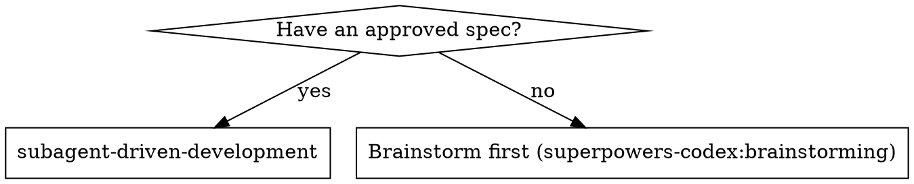
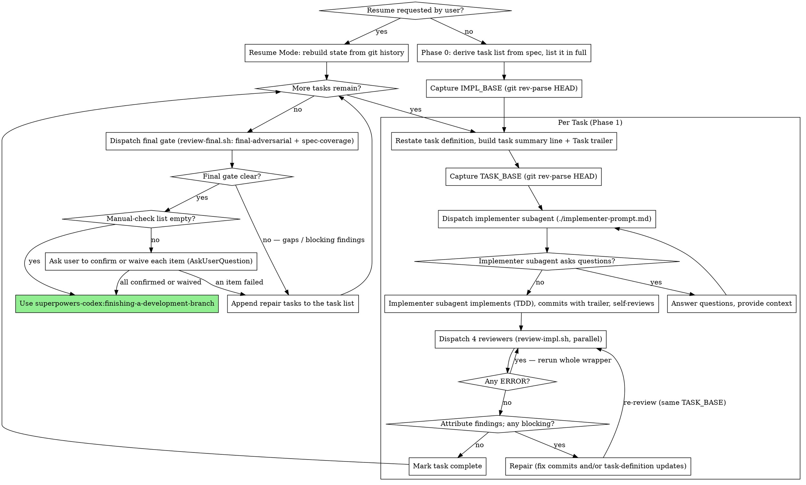

# Plan-Free Task Execution Implementation Plan

> **For agentic workers:** REQUIRED SUB-SKILL: Use superpowers-codex:subagent-driven-development to implement this plan task-by-task. Steps use checkbox (`- [ ]`) syntax for tracking.

**Goal:** Replace the `writing-plans` stage with spec-driven execution: subagent-driven-development derives a code-free task list from the approved spec, implements each task with TDD, and reviews each task with four reviewers (spec-compliance, code-quality, task-coverage, task-seam) plus a final gate (final-adversarial + spec-coverage).

**Architecture:** The review wrappers `scripts/review-impl.sh` and `scripts/review-final.sh` get new interfaces (`--spec`/`--task-summary`/`--task-base` and `--base`/`--spec`) and register the new reviewer prompts that live under `skills/subagent-driven-development/`. The SDD `SKILL.md` is rewritten around Phase 0 task derivation, finding attribution, commit trailers, and git-history resume. brainstorming hands off directly to SDD; `writing-plans`, `review-plan.sh`, and the plan-cleanup step in finishing are removed.

**Tech Stack:** Bash (wrappers and their test harness `scripts/review-batch-lib.test.sh`), Markdown skill and prompt files, codex companion via `scripts/dispatch.sh`.

**Source spec:** `docs/superpowers/specs/2026-10-11-plan-free-task-execution-design.md`

---

## Execution note: review with a pre-implementation snapshot

This plugin runs directly from this repository, so the review wrappers and reviewer prompts used to review each Task are themselves modified by this plan. The controller executing this plan follows the currently loaded (pre-change) subagent-driven-development skill, which calls the wrappers with the old interface (`review-impl.sh --plan --task --task-base`, `review-final.sh --base`). Calling the in-repo wrappers after Task 1 or Task 2 lands would fail or load half-migrated prompts.

Therefore, before dispatching the first implementer, the controller captures `IMPL_BASE` and extracts a read-only snapshot of the plugin at that commit into its scratchpad:

```bash
IMPL_BASE="$(git rev-parse HEAD)"
SNAP="<scratchpad>/plugin-snapshot"
mkdir -p "$SNAP"
git archive "$IMPL_BASE" scripts skills | tar -x -C "$SNAP"
```

For every review during this plan's execution, invoke the snapshot wrappers (`"$SNAP/scripts/review-impl.sh"` and `"$SNAP/scripts/review-final.sh"`) with the old interface, from the repository root, instead of `${CLAUDE_PLUGIN_ROOT}/scripts/...`. The wrappers resolve their prompts relative to their own directory, so the snapshot reviews every Task with the pre-change reviewer pipeline. All other review rules (foreground call, read `=== Summary ===`, HEAD contract) are unchanged.

Task order: Tasks 1–3 (wrappers and tests), Tasks 4–7 (reviewer prompts and final focus), Tasks 8–10 (SDD sidecars and SKILL.md), Tasks 11–14 (brainstorming, finishing, removal of writing-plans, README and metadata). Intermediate commits may reference files added by later Tasks; the repository is consistent after Task 14.

---

### Task 1: review-impl.sh four-reviewer interface

**Files:**
- Modify: `scripts/review-batch-lib.test.sh` (the review-impl test block)
- Modify: `scripts/review-impl.sh`

**Goal:** `review-impl.sh` takes `--spec`, `--task-summary`, `--task-base` (all required) plus optional `--max-parallel`, drops `--plan`/`--task`, and registers four jobs in this order: `spec-compliance`, `code-quality`, `task-coverage`, `task-seam`.

- [ ] **Step 1: Replace the review-impl tests**

In `scripts/review-batch-lib.test.sh`, replace the whole block that starts with

```bash
# review-impl.sh assembles the spec-compliance + code-quality dispatch argv (no report file).
```

and ends with

```bash
  ok "review-impl: code-quality argv matches expected wrapper contract"
else bad "review-impl: code-quality argv" "$T8"; fi
```

(the line right after it is blank, followed by `# review-final.sh assembles the final adversarial reviewer's dispatch argv from its CLI.`) with:

```bash
# section_args <blob> <label> : print the echoed ARG: lines of the "## <label>" section joined
# by "|" (the section ends at the next "## " heading or the Summary block), so one string
# comparison pins a job's exact argv, including order and the absence of extra arguments.
section_args() {
  printf '%s\n' "$1" \
    | awk -v h="## $2" '$0==h{c=1;next} c&&(/^## /||/^=== Summary ===$/){c=0} c{print}' \
    | grep '^ARG:' | tr '\n' '|'
}

# review-impl.sh assembles the four per-Task reviewers' dispatch argv (no report file).
IMPL_W="$HERE/review-impl.sh"
PROOT="${PROOT:-$ROOT/plugin}"   # fixture plugin root (defined locally)
SDD_DIR="$PROOT/skills/subagent-driven-development"
mkdir -p "$SDD_DIR"
: > "$SDD_DIR/spec-reviewer-prompt.md"
: > "$SDD_DIR/task-coverage-prompt.md"
: > "$SDD_DIR/task-seam-prompt.md"
# The task summary carries spaces, a colon, parentheses and a non-ASCII "§": it must reach
# dispatch.sh as ONE intact --set value.
IMPL_SUMMARY='Task 2: Retry policy (spec §4.2)'
T8="$( BATCH_DISPATCH_SH="$ECHO_STUB" PLUGIN_ROOT="$PROOT" \
       bash "$IMPL_W" --spec docs/specs/x.md --task-summary "$IMPL_SUMMARY" \
         --task-base TBASE 2>/dev/null )"
# exactly four jobs, labels in registration order
IMPL_LABELS="$(printf '%s\n' "$T8" | grep '^## ' | tr '\n' '|')"
[ "$IMPL_LABELS" = '## spec-compliance|## code-quality|## task-coverage|## task-seam|' ] \
  && ok "review-impl: four jobs registered in order" \
  || bad "review-impl: four jobs registered in order" "labels=$IMPL_LABELS"
# spec-compliance: task --prompt <root>/.../spec-reviewer-prompt.md + SPEC_FILE_PATH, TASK_SUMMARY, TASK_BASE
IMPL_SC="$(section_args "$T8" spec-compliance)"
[ "$IMPL_SC" = "ARG:task|ARG:--prompt|ARG:$SDD_DIR/spec-reviewer-prompt.md|ARG:--set|ARG:SPEC_FILE_PATH=docs/specs/x.md|ARG:--set|ARG:TASK_SUMMARY=$IMPL_SUMMARY|ARG:--set|ARG:TASK_BASE=TBASE|" ] \
  && ok "review-impl: spec-compliance argv matches expected wrapper contract" \
  || bad "review-impl: spec-compliance argv" "$IMPL_SC"
# NO --report-file anywhere
printf '%s\n' "$T8" | grep -q -- '--report-file' \
  && bad "review-impl: no --report-file passed" "$T8" \
  || ok "review-impl: no --report-file passed"
# code-quality: review --base <TASK_BASE>
IMPL_CQ="$(section_args "$T8" code-quality)"
[ "$IMPL_CQ" = 'ARG:review|ARG:--base|ARG:TBASE|' ] \
  && ok "review-impl: code-quality argv matches expected wrapper contract" \
  || bad "review-impl: code-quality argv" "$IMPL_CQ"
# task-coverage: task --prompt <root>/.../task-coverage-prompt.md + SPEC_FILE_PATH, TASK_SUMMARY, TASK_BASE
IMPL_TC="$(section_args "$T8" task-coverage)"
[ "$IMPL_TC" = "ARG:task|ARG:--prompt|ARG:$SDD_DIR/task-coverage-prompt.md|ARG:--set|ARG:SPEC_FILE_PATH=docs/specs/x.md|ARG:--set|ARG:TASK_SUMMARY=$IMPL_SUMMARY|ARG:--set|ARG:TASK_BASE=TBASE|" ] \
  && ok "review-impl: task-coverage argv matches expected wrapper contract" \
  || bad "review-impl: task-coverage argv" "$IMPL_TC"
# task-seam: task --prompt <root>/.../task-seam-prompt.md + TASK_BASE only (never reads the spec)
IMPL_TS="$(section_args "$T8" task-seam)"
[ "$IMPL_TS" = "ARG:task|ARG:--prompt|ARG:$SDD_DIR/task-seam-prompt.md|ARG:--set|ARG:TASK_BASE=TBASE|" ] \
  && ok "review-impl: task-seam argv carries only TASK_BASE (no SPEC_FILE_PATH)" \
  || bad "review-impl: task-seam argv carries only TASK_BASE (no SPEC_FILE_PATH)" "$IMPL_TS"
# impl_expect_err <name> <expected-stderr-fragment> <wrapper-args...> : the wrapper must exit
# nonzero with the given wrapper error, never crash on `set -u`, and dispatch no job.
impl_expect_err() {
  local name="$1" want="$2" out rc; shift 2
  out="$( BATCH_DISPATCH_SH="$ECHO_STUB" PLUGIN_ROOT="$PROOT" bash "$IMPL_W" "$@" 2>&1 )"
  rc=$?
  if [ "$rc" -ne 0 ] \
     && printf '%s\n' "$out" | grep -qF "$want" \
     && ! printf '%s\n' "$out" | grep -qi 'unbound variable' \
     && ! printf '%s\n' "$out" | grep -q '^## '; then
    ok "$name"
  else bad "$name" "rc=$rc out=$out"; fi
}
impl_expect_err "review-impl: missing --spec fails fast with a clear error" \
  'review-impl: --spec is required' \
  --task-summary "$IMPL_SUMMARY" --task-base TBASE
impl_expect_err "review-impl: missing --task-summary fails fast with a clear error" \
  'review-impl: --task-summary is required' \
  --spec docs/specs/x.md --task-base TBASE
impl_expect_err "review-impl: missing --task-base fails fast with a clear error" \
  'review-impl: --task-base is required' \
  --spec docs/specs/x.md --task-summary "$IMPL_SUMMARY"
impl_expect_err "review-impl: missing option value fails with a clear wrapper error" \
  'review-impl: --spec requires a value' \
  --task-summary "$IMPL_SUMMARY" --task-base TBASE --spec
impl_expect_err "review-impl: removed --plan fails as unknown arg" \
  'review-impl: unknown arg: --plan' \
  --plan docs/plans/x.md --spec docs/specs/x.md --task-summary "$IMPL_SUMMARY" --task-base TBASE
impl_expect_err "review-impl: removed --task fails as unknown arg" \
  'review-impl: unknown arg: --task' \
  --task "Task 2" --spec docs/specs/x.md --task-summary "$IMPL_SUMMARY" --task-base TBASE
```

Notes:
- The echo stub does not run `dispatch.sh`'s `*_FILE_PATH` existence check, so `docs/specs/x.md` does not need to exist.
- A newline inside `--task-summary` is rejected by `dispatch.sh` (`require_no_newline`), not by the wrapper; it is not tested here because the echo stub bypasses `dispatch.sh`.

- [ ] **Step 2: Run the tests and watch them fail**

Run: `bash scripts/review-batch-lib.test.sh`

Expected: exit status 1, with these `FAIL` lines (the old wrapper rejects `--spec` as `review-impl: unknown arg: --spec`, so no job is registered and none of the new error messages appear):

```
FAIL - review-impl: four jobs registered in order
FAIL - review-impl: spec-compliance argv
FAIL - review-impl: code-quality argv
FAIL - review-impl: task-coverage argv
FAIL - review-impl: task-seam argv carries only TASK_BASE (no SPEC_FILE_PATH)
FAIL - review-impl: missing --spec fails fast with a clear error
FAIL - review-impl: missing --task-summary fails fast with a clear error
FAIL - review-impl: missing --task-base fails fast with a clear error
FAIL - review-impl: missing option value fails with a clear wrapper error
FAIL - review-impl: removed --plan fails as unknown arg
FAIL - review-impl: removed --task fails as unknown arg
```

and the last line `60 passed, 11 failed`. (`review-impl: no --report-file passed` still prints `ok` because the empty output contains no `--report-file`.)

- [ ] **Step 3: Rewrite `scripts/review-impl.sh`**

Full new content:

```bash
#!/usr/bin/env bash
# Subagent-driven-development per-task review wrapper: dispatch the spec-compliance,
# code-quality, task-coverage and task-seam reviewers in parallel for one Task.
# Usage: review-impl.sh --spec <design.md> --task-summary "Task N: <name> (spec §X)" \
#          --task-base <TASK_BASE> [--max-parallel N]
# --task-summary must be a single line: dispatch.sh rejects a --set value containing a newline.
set -euo pipefail

SCRIPT_DIR="$(cd "$(dirname "$0")" && pwd)"
# BATCH_DISPATCH_SH is a deliberate TEST SEAM: review-batch-lib.test.sh injects a stub dispatch.sh
# through it for hermetic testing. With no override it resolves to the real dispatch.sh; keep it.
BATCH_DISPATCH_SH="${BATCH_DISPATCH_SH:-$SCRIPT_DIR/dispatch.sh}"
PLUGIN_ROOT="${PLUGIN_ROOT:-$SCRIPT_DIR/..}"
export BATCH_DISPATCH_SH

# need_val: fail with a clear wrapper error when an option is missing its value, instead
# of crashing on an unbound `$2` under `set -u`.
need_val() { [ "$2" -ge 2 ] || { printf 'review-impl: %s requires a value\n' "$1" >&2; exit 1; }; }

SPEC=""; TASK_SUMMARY=""; TASK_BASE=""
while [ $# -gt 0 ]; do
  case "$1" in
    --spec)         need_val "$1" "$#"; SPEC="$2"; shift 2 ;;
    --task-summary) need_val "$1" "$#"; TASK_SUMMARY="$2"; shift 2 ;;
    --task-base)    need_val "$1" "$#"; TASK_BASE="$2"; shift 2 ;;
    --max-parallel) need_val "$1" "$#"; MAX_PARALLEL="$2"; shift 2 ;;
    *) printf 'review-impl: unknown arg: %s\n' "$1" >&2; exit 1 ;;
  esac
done
[ -n "$SPEC" ]         || { printf 'review-impl: --spec is required\n' >&2; exit 1; }
[ -n "$TASK_SUMMARY" ] || { printf 'review-impl: --task-summary is required\n' >&2; exit 1; }
[ -n "$TASK_BASE" ]    || { printf 'review-impl: --task-base is required\n' >&2; exit 1; }

SDD_DIR="$PLUGIN_ROOT/skills/subagent-driven-development"

# shellcheck source=./review-batch-lib.sh
. "$SCRIPT_DIR/review-batch-lib.sh"
batch_init
batch_add "spec-compliance" task \
  --prompt "$SDD_DIR/spec-reviewer-prompt.md" \
  --set "SPEC_FILE_PATH=$SPEC" \
  --set "TASK_SUMMARY=$TASK_SUMMARY" \
  --set "TASK_BASE=$TASK_BASE"
batch_add "code-quality" review --base "$TASK_BASE"
batch_add "task-coverage" task \
  --prompt "$SDD_DIR/task-coverage-prompt.md" \
  --set "SPEC_FILE_PATH=$SPEC" \
  --set "TASK_SUMMARY=$TASK_SUMMARY" \
  --set "TASK_BASE=$TASK_BASE"
# task-seam never reads the spec: it checks the diff against the existing code only.
batch_add "task-seam" task \
  --prompt "$SDD_DIR/task-seam-prompt.md" \
  --set "TASK_BASE=$TASK_BASE"
batch_run
```

- [ ] **Step 4: Run tests, shellcheck, and syntax check**

Run: `bash scripts/review-batch-lib.test.sh`
Expected: no `FAIL` lines; last line `71 passed, 0 failed`; exit status 0.

Run: `(cd scripts && shellcheck -x review-impl.sh) && bash -n scripts/review-impl.sh && bash -n scripts/review-batch-lib.test.sh`
Expected: no output, exit status 0. (`shellcheck -x` runs from `scripts/` so the `# shellcheck source=./review-batch-lib.sh` directive resolves; without it shellcheck reports the pre-existing SC2034/SC1091 on `MAX_PARALLEL` and the sourced library.)

- [ ] **Step 5: Commit**

Use the `git-master` skill with exactly these paths and this message:

```bash
git add scripts/review-impl.sh scripts/review-batch-lib.test.sh
git commit -m "$(cat <<'EOF'
feat!: switch review-impl.sh to spec-based four-reviewer interface

review-impl.sh now takes --spec, --task-summary and --task-base (all
required) and dispatches spec-compliance, code-quality, task-coverage and
task-seam in parallel. --plan and --task are removed.

BREAKING CHANGE: review-impl.sh no longer accepts --plan or --task.

Co-Authored-By: Claude Opus 5.5 <noreply@anthropic.com>
EOF
)"
```

---

### Task 2: review-final.sh spec-coverage reviewer

**Files:**
- Modify: `scripts/review-batch-lib.test.sh` (the review-final test block)
- Modify: `scripts/review-final.sh`

**Goal:** `review-final.sh` requires `--base` and `--spec` and registers `final-adversarial` (argv unchanged, never receives the spec) followed by `spec-coverage`.

- [ ] **Step 1: Replace the review-final tests**

In `scripts/review-batch-lib.test.sh`, replace the whole block that starts with

```bash
# review-final.sh assembles the final adversarial reviewer's dispatch argv from its CLI.
```

and ends with

```bash
  ok "review-final: missing --base value fails with a clear wrapper error"
else bad "review-final: missing --base value fails with a clear wrapper error" "rc=$RC_FINAL out=$FINAL_ERR"; fi
```

(the line right after it is blank, followed by `# decide_action <stdout-blob> <exit-code> : print PROCEED | RERUN_WRAPPER | FIX_AND_REREVIEW | INSPECT.`) with:

```bash
# review-final.sh assembles the final-adversarial + spec-coverage dispatch argv from its CLI.
FINAL_W="$HERE/review-final.sh"
PROOT="${PROOT:-$ROOT/plugin}"   # fixture plugin root (defined locally)
SDD_DIR="$PROOT/skills/subagent-driven-development"
mkdir -p "$SDD_DIR"
: > "$SDD_DIR/final-code-reviewer-focus.md"
: > "$SDD_DIR/spec-coverage-prompt.md"
T_FINAL="$( BATCH_DISPATCH_SH="$ECHO_STUB" PLUGIN_ROOT="$PROOT" \
       bash "$FINAL_W" --base IMPLBASE --spec docs/specs/x.md 2>/dev/null )"
# exactly two jobs, labels in registration order
FINAL_LABELS="$(printf '%s\n' "$T_FINAL" | grep '^## ' | tr '\n' '|')"
[ "$FINAL_LABELS" = '## final-adversarial|## spec-coverage|' ] \
  && ok "review-final: two jobs registered in order" \
  || bad "review-final: two jobs registered in order" "labels=$FINAL_LABELS"
# final-adversarial: adversarial --base <IMPL_BASE> --focus <root>/.../final-code-reviewer-focus.md
# (unchanged; it never receives the spec)
FINAL_ADV="$(section_args "$T_FINAL" final-adversarial)"
[ "$FINAL_ADV" = "ARG:adversarial|ARG:--base|ARG:IMPLBASE|ARG:--focus|ARG:$SDD_DIR/final-code-reviewer-focus.md|" ] \
  && ok "review-final: final-adversarial argv matches expected wrapper contract" \
  || bad "review-final: final-adversarial argv" "$FINAL_ADV"
# spec-coverage: task --prompt <root>/.../spec-coverage-prompt.md + SPEC_FILE_PATH, IMPL_BASE
FINAL_SCOV="$(section_args "$T_FINAL" spec-coverage)"
[ "$FINAL_SCOV" = "ARG:task|ARG:--prompt|ARG:$SDD_DIR/spec-coverage-prompt.md|ARG:--set|ARG:SPEC_FILE_PATH=docs/specs/x.md|ARG:--set|ARG:IMPL_BASE=IMPLBASE|" ] \
  && ok "review-final: spec-coverage argv matches expected wrapper contract" \
  || bad "review-final: spec-coverage argv" "$FINAL_SCOV"
# final_expect_err <name> <expected-stderr-fragment> <wrapper-args...> : the wrapper must exit
# nonzero with the given wrapper error, never crash on `set -u`, and dispatch no job.
final_expect_err() {
  local name="$1" want="$2" out rc; shift 2
  out="$( BATCH_DISPATCH_SH="$ECHO_STUB" PLUGIN_ROOT="$PROOT" bash "$FINAL_W" "$@" 2>&1 )"
  rc=$?
  if [ "$rc" -ne 0 ] \
     && printf '%s\n' "$out" | grep -qF "$want" \
     && ! printf '%s\n' "$out" | grep -qi 'unbound variable' \
     && ! printf '%s\n' "$out" | grep -q '^## '; then
    ok "$name"
  else bad "$name" "rc=$rc out=$out"; fi
}
final_expect_err "review-final: missing --base fails fast with a clear error" \
  'review-final: --base is required' \
  --spec docs/specs/x.md
final_expect_err "review-final: missing --spec fails fast with a clear error" \
  'review-final: --spec is required' \
  --base IMPLBASE
final_expect_err "review-final: missing --base value fails with a clear wrapper error" \
  'review-final: --base requires a value' \
  --spec docs/specs/x.md --base
```

`section_args` is the helper added above the review-impl block in Task 1.

- [ ] **Step 2: Run the tests and watch them fail**

Run: `bash scripts/review-batch-lib.test.sh`

Expected: exit status 1, with these `FAIL` lines (the old wrapper rejects `--spec` as `review-final: unknown arg: --spec`, so no job is registered and none of the expected error messages appear):

```
FAIL - review-final: two jobs registered in order
FAIL - review-final: final-adversarial argv
FAIL - review-final: spec-coverage argv
FAIL - review-final: missing --base fails fast with a clear error
FAIL - review-final: missing --spec fails fast with a clear error
FAIL - review-final: missing --base value fails with a clear wrapper error
```

and the last line `69 passed, 6 failed`.

- [ ] **Step 3: Rewrite `scripts/review-final.sh`**

Full new content:

```bash
#!/usr/bin/env bash
# Subagent-driven-development final merge-gate wrapper: dispatch the final adversarial
# reviewer and the spec-coverage reviewer in one batch.
# Usage: review-final.sh --base <IMPL_BASE> --spec <design.md> [--max-parallel N]
set -euo pipefail

SCRIPT_DIR="$(cd "$(dirname "$0")" && pwd)"
# BATCH_DISPATCH_SH is a deliberate TEST SEAM: review-batch-lib.test.sh injects a stub dispatch.sh
# through it for hermetic testing. With no override it resolves to the real dispatch.sh; keep it.
BATCH_DISPATCH_SH="${BATCH_DISPATCH_SH:-$SCRIPT_DIR/dispatch.sh}"
PLUGIN_ROOT="${PLUGIN_ROOT:-$SCRIPT_DIR/..}"
export BATCH_DISPATCH_SH

# need_val: fail with a clear wrapper error when an option is missing its value, instead
# of crashing on an unbound `$2` under `set -u`.
need_val() { [ "$2" -ge 2 ] || { printf 'review-final: %s requires a value\n' "$1" >&2; exit 1; }; }

BASE=""; SPEC=""
while [ $# -gt 0 ]; do
  case "$1" in
    --base)         need_val "$1" "$#"; BASE="$2"; shift 2 ;;
    --spec)         need_val "$1" "$#"; SPEC="$2"; shift 2 ;;
    --max-parallel) need_val "$1" "$#"; MAX_PARALLEL="$2"; shift 2 ;;
    *) printf 'review-final: unknown arg: %s\n' "$1" >&2; exit 1 ;;
  esac
done
[ -n "$BASE" ] || { printf 'review-final: --base is required\n' >&2; exit 1; }
[ -n "$SPEC" ] || { printf 'review-final: --spec is required\n' >&2; exit 1; }

SDD_DIR="$PLUGIN_ROOT/skills/subagent-driven-development"

# shellcheck source=./review-batch-lib.sh
. "$SCRIPT_DIR/review-batch-lib.sh"
batch_init
# final-adversarial reviews the code only and never receives the spec.
batch_add "final-adversarial" adversarial \
  --base "$BASE" \
  --focus "$SDD_DIR/final-code-reviewer-focus.md"
batch_add "spec-coverage" task \
  --prompt "$SDD_DIR/spec-coverage-prompt.md" \
  --set "SPEC_FILE_PATH=$SPEC" \
  --set "IMPL_BASE=$BASE"
batch_run
```

- [ ] **Step 4: Run tests, shellcheck, and syntax check**

Run: `bash scripts/review-batch-lib.test.sh`
Expected: no `FAIL` lines; last line `75 passed, 0 failed`; exit status 0.

Run: `(cd scripts && shellcheck -x review-final.sh) && bash -n scripts/review-final.sh && bash -n scripts/review-batch-lib.test.sh`
Expected: no output, exit status 0.

- [ ] **Step 5: Commit**

Use the `git-master` skill with exactly these paths and this message:

```bash
git add scripts/review-final.sh scripts/review-batch-lib.test.sh
git commit -m "$(cat <<'EOF'
feat: add spec-coverage reviewer to review-final.sh

review-final.sh now requires --spec and dispatches a spec-coverage reviewer
(SPEC_FILE_PATH, IMPL_BASE) alongside the unchanged final-adversarial
reviewer.

Co-Authored-By: Claude Opus 5.5 <noreply@anthropic.com>
EOF
)"
```

---

### Task 3: Remove review-plan.sh

**Files:**
- Delete: `scripts/review-plan.sh`
- Modify: `scripts/review-batch-lib.test.sh` (review-plan tests, plan caller shape, plan `expect_action` lines)

**Goal:** the plan-review wrapper and every test that exercises it or the plan caller shape are gone; a guard test keeps the wrapper from returning.

- [ ] **Step 1: Replace the review-plan tests with a removal guard and drop the plan caller shape**

In `scripts/review-batch-lib.test.sh`:

(a) Replace the whole block that starts with

```bash
# review-plan.sh assembles per-Task (+ optional coverage) dispatch argv from its CLI.
```

and ends with

```bash
  ok "review-plan: missing option value fails with a clear wrapper error"
else bad "review-plan: missing option value fails with a clear wrapper error" "rc=$RC_MALFORMED out=$PLAN_ERR"; fi
```

with:

```bash
# The plan-review wrapper is retired: no review-plan.sh may ship next to the other wrappers.
[ ! -e "$HERE/review-plan.sh" ] \
  && ok "review-plan.sh wrapper is removed" \
  || bad "review-plan.sh wrapper is removed" "still present: $HERE/review-plan.sh"
```

(b) Delete the whole plan caller-shape fixture block, from

```bash
# --- plan caller shape: per-task (Status:) + coverage-verifier (Status:) ---
```

through

```bash
  '- coverage-verifier: Status: OKAY')"; PL_FIND_RC=0
```

plus the blank line after it, so `# --- impl caller shape: spec-compliance (Status:) + code-quality (prose, no verdict line) ---` directly follows the brainstorm fixtures' blank line.

(c) Delete these three lines:

```bash
expect_action "plan all-clear (rc 0)"              "$PL_OK"   "$PL_OK_RC"   "PROCEED"
expect_action "plan ERROR (rc nonzero)"            "$PL_ERR"  "$PL_ERR_RC"  "RERUN_WRAPPER"
expect_action "plan Issues Found (rc 0)"           "$PL_FIND" "$PL_FIND_RC" "FIX_AND_REREVIEW"
```

(d) The nonzero-rc regression test used the deleted plan fixture; point it at the impl findings fixture. Replace

```bash
expect_action "findings stdout with nonzero rc still FIX_AND_REREVIEW" "$PL_FIND" 7 "FIX_AND_REREVIEW"
```

with

```bash
expect_action "findings stdout with nonzero rc still FIX_AND_REREVIEW" "$IM_FIND" 7 "FIX_AND_REREVIEW"
```

After these edits, `grep -nE '(^|[^M])PL_|PLAN_W|T7|writing-plans|review-plan: ' scripts/review-batch-lib.test.sh` prints nothing and exits 1 (the `[^M]` keeps `IMPL_*` names from matching).

- [ ] **Step 2: Run the tests and watch them fail**

Run: `bash scripts/review-batch-lib.test.sh`

Expected: exit status 1, with exactly one failure (the wrapper file still exists):

```
FAIL - review-plan.sh wrapper is removed
   still present: <repo>/scripts/review-plan.sh
```

and the last line `67 passed, 1 failed`.

- [ ] **Step 3: Delete the wrapper**

Run: `git rm scripts/review-plan.sh`
Expected: `rm 'scripts/review-plan.sh'`

- [ ] **Step 4: Run tests and syntax check**

Run: `bash scripts/review-batch-lib.test.sh`
Expected: no `FAIL` lines; last line `68 passed, 0 failed`; exit status 0.

Run: `bash scripts/dispatch.test.sh` — expected last line `17 passed, 0 failed`.
Run: `bash scripts/preflight.test.sh` — expected last line `6 passed, 0 failed`.
Run: `bash -n scripts/review-batch-lib.test.sh` — expected no output, exit status 0.
Run the no-new-findings ShellCheck gate for the test harness. It already carries info/warning findings (SC1090, SC2015, and others) that predate this plan and are out of scope, so the gate compares the set of findings — with the `file:line:col:` prefix stripped — against commit `6925f86f76679588dc8fbaf4948a8011d4575609`, the last commit that touched the harness before this plan; this check covers all harness changes from Tasks 1–3:

```bash
cd scripts && comm -13 \
  <(git show 6925f86f76679588dc8fbaf4948a8011d4575609:scripts/review-batch-lib.test.sh | shellcheck -x -f gcc - | sed -E 's/^[^:]*:[0-9]+:[0-9]+: //' | sort -u) \
  <(shellcheck -x -f gcc review-batch-lib.test.sh | sed -E 's/^[^:]*:[0-9]+:[0-9]+: //' | sort -u); cd ..
```

Expected: no output (no finding that was absent before this plan). Any printed line is a newly introduced finding; fix it in the test harness and re-run.

- [ ] **Step 5: Commit**

Use the `git-master` skill with exactly these paths and this message (`scripts/review-plan.sh` is already staged as a deletion by `git rm`):

```bash
git add scripts/review-batch-lib.test.sh
git commit -m "$(cat <<'EOF'
feat!: remove review-plan.sh wrapper

The plan-review stage is gone, so the review-plan.sh wrapper, its tests and
the plan caller-shape fixtures are removed. A guard test keeps the wrapper
from being reintroduced.

BREAKING CHANGE: scripts/review-plan.sh no longer exists.

Co-Authored-By: Claude Opus 5.5 <noreply@anthropic.com>
EOF
)"
```

### Task 4: Rewrite spec-reviewer-prompt.md against the spec

**Files:**
- Modify (full rewrite): `skills/subagent-driven-development/spec-reviewer-prompt.md`

**Goal:** The spec-compliance reviewer judges the diff against the spec (the only requirement truth), uses the one-line task summary only to scope which spec sections apply, applies the shared evidence rules, checks Non-goals, no longer checks missing requirements (moved to task-coverage), and ignores changes to the spec file itself. Placeholders are exactly `[SPEC_FILE_PATH]`, `[TASK_SUMMARY]`, `[TASK_BASE]`.

- [ ] **Step 1: Replace the file with this complete content**

````markdown
You are a spec compliance reviewer executed by the codex companion. You verify whether an
implementation correctly realizes its specification. Verify independently from the diff and
the spec; do not assume the implementation is correct — read the actual code and git history.

**Spec file:** [SPEC_FILE_PATH]
**Task summary:** [TASK_SUMMARY]
**Task base commit:** [TASK_BASE]

The spec file is the only source of truth for requirements. The task summary is a single
line naming the spec sections this change is responsible for. Use it only to scope which
part of the spec applies to this diff; it is never a requirement in itself. Before reviewing,
read in full: the spec sections the task summary lists, every other spec section those
sections depend on (definitions, shared rules, design decisions they refer to), and any
section of the spec that lists Non-goals or Accepted limitations.

Your single source of truth for what was actually built is `git diff [TASK_BASE]..HEAD`,
NOT any prose summary.

## The Spec File Is Not Implementation

The diff may contain changes to `[SPEC_FILE_PATH]` itself (spec amendments committed while
the implementation was in progress). Those changes are not implementation: do not report
them under Extra/unneeded work or any other check, and never count them as evidence. Review
against the spec as it exists at `HEAD`.

## CRITICAL: Verify Independently From the Diff

You receive no prose summary from the implementer — only the diff, the task summary, and the
spec. The implementation may be incomplete, inaccurate, or optimistic. You MUST verify
everything independently from the diff.

**DO NOT:**
- Assume a requirement was met because the task summary or a commit message says so
- Trust commit messages as evidence
- Accept a looser interpretation of requirements than the spec states

**DO:**
- Run `git diff [TASK_BASE]..HEAD` to read the actual code changes
- Compare the actual implementation to the requirements of the listed spec sections line by line
- Look for extra changes the listed spec sections did not call for

## How to Read the Implementation

Run this git command yourself to see exactly what was changed:

git diff [TASK_BASE]..HEAD

This is a literal two-dot range covering all commits since that base — read every file
changed and every line added or removed.

## Your Job

Read the implementation code and verify the following. Whether every requirement of the
listed sections has been implemented is checked by a separate coverage reviewer; report a
requirement here only when what the diff does is wrong, extra, insufficiently evidenced, or
a non-goal.

**Extra/unneeded work:**
- Did they build things the listed spec sections do not call for?
- Did they over-engineer or add unnecessary features?
- Did they add "nice to haves" that are not in the spec?

**Misunderstandings:**
- Did they interpret requirements differently than the spec intends?
- Did they solve the wrong problem?
- Did they implement the right feature but the wrong way — for example by contradicting a
  design decision the spec states (architecture, data structure, API shape, error-handling
  strategy, or which component owns a responsibility)?

**Non-goals:**
- Does the diff implement anything the spec explicitly lists as not to be done, in a
  Non-goals list or in a Non-goals / Accepted limitations section? Implementing an item the
  spec declares out of scope is an issue even if it works correctly.
- If the spec has no such list or section, this check has nothing to flag.

**Evidence:** for every requirement the diff implements within the listed spec sections,
apply the Evidence Rules below. An implemented requirement that lacks the sufficient evidence
for its category is an issue.

**Verify by reading the diff, not by trusting any prose summary.**

## Evidence Rules

Classify every requirement into exactly one category below and require the sufficient
evidence for that category. A requirement whose sufficient evidence is absent is not met.

| Category | Examples | Sufficient evidence |
|---|---|---|
| Executable behavior | function return values, CLI behavior, error handling | The implementation location AND test evidence. If a test could have been written but was not, the requirement is not met. |
| Declarative / documentation change | skill instruction text, README, configuration values, prompt content | The corresponding location is enough; no executable test is required. The location may be in the diff or in content that already exists at `HEAD` (for example, a documentation requirement in the same section that an earlier task already completed). |
| Preserve unchanged | files or content the spec explicitly says to keep or not to change | The content still exists at `HEAD` and the diff does not modify it. No diff location is required. |
| Inherently manual | side effects on external systems, behavior that can only be observed by a human operating the system | Annotate the item as `needs manual confirmation`. Do not report it as missing or unmet; it does not affect the final Status line. |

Never accept a commit message, a code comment, or a prose summary as evidence. Changes to
`[SPEC_FILE_PATH]` itself are never evidence for any category.

## Issue Reporting Requirements

> **MANDATORY — zero exceptions:** For every issue you find, you MUST provide ALL of the following. Omitting either item is a reviewer error.
>
> 1. **Precise location** — the exact file path and line number(s) where the problem occurs (e.g. `src/foo/bar.ts:42`).
> 2. **Concrete fix** — a complete patch or directly-applicable replacement code that resolves the issue. You MUST NOT describe what should change in prose without also supplying actual code. "This function should validate X" is forbidden; a diff or replacement snippet is required.

Items annotated `needs manual confirmation` are not issues. List each one under a
`Needs manual confirmation:` heading before your final line, stating what a human must
confirm and the related file:line location.

## Output Contract

Your final output line MUST be exactly one of:

Status: OKAY
(if the implementation is spec-compliant after code inspection; `needs manual confirmation` items alone do not prevent this)

Status: Issues Found
(followed by each issue with its exact file:line location AND a concrete code fix — never prose-only descriptions)

No other final line format is accepted.
````

- [ ] **Step 2: Verify placeholders, wording, and dispatch substitution**

Run:

```bash
grep -Eo '\[[A-Z_][A-Z0-9_]*\]' skills/subagent-driven-development/spec-reviewer-prompt.md | sort -u
```

Expected output (exactly these three lines):

```
[SPEC_FILE_PATH]
[TASK_BASE]
[TASK_SUMMARY]
```

Run:

```bash
grep -niE 'plan|Missing requirements|TASK_ID' skills/subagent-driven-development/spec-reviewer-prompt.md
```

Expected: no output, exit status 1.

Run:

```bash
bash scripts/dispatch.sh task --dry-run \
  --prompt skills/subagent-driven-development/spec-reviewer-prompt.md \
  --set SPEC_FILE_PATH=docs/superpowers/specs/2026-10-11-plan-free-task-execution-design.md \
  --set "TASK_SUMMARY=Task 1: x (spec §1)" \
  --set TASK_BASE=HEAD
```

Expected: exit status 0; output starts with `--- DRY RUN: command ---`, then a `node ... task --prompt-file ...` line (the companion path may show as `<companion-unresolved>`), then `--- DRY RUN: prompt ---` followed by the prompt with `**Task summary:** Task 1: x (spec §1)` and `git diff HEAD..HEAD`; no `unsubstituted placeholder(s) remain` on stderr. (`--dry-run` does not require the codex companion; it only fails if a companion is resolved at an unversioned path, which is an environment problem, not a prompt problem.)

Run the negative check, omitting `TASK_SUMMARY`:

```bash
bash scripts/dispatch.sh task --dry-run \
  --prompt skills/subagent-driven-development/spec-reviewer-prompt.md \
  --set SPEC_FILE_PATH=docs/superpowers/specs/2026-10-11-plan-free-task-execution-design.md \
  --set TASK_BASE=HEAD
```

Expected: non-zero exit; stderr contains `unsubstituted placeholder(s) remain:`, the line `[TASK_SUMMARY]`, and `provide a --set for each placeholder.`

- [ ] **Step 3: Commit (via the git-master skill)**

```bash
git add skills/subagent-driven-development/spec-reviewer-prompt.md
git commit -m "feat: verify spec compliance against the spec instead of the plan" \
  -m "The spec-compliance reviewer now reads the spec sections named by a one-line task summary, applies shared evidence rules, checks spec Non-goals, ignores changes to the spec file itself, and leaves completeness to a separate coverage reviewer." \
  -m "Co-Authored-By: Claude Opus 5.5 <noreply@anthropic.com>"
```

### Task 5: Add task-coverage-prompt.md

**Files:**
- Create: `skills/subagent-driven-development/task-coverage-prompt.md`

**Goal:** A per-task coverage reviewer (derived from the plan coverage verifier) that lists every requirement and must/should-type condition in the spec sections named by the task summary, demands the shared-evidence-rule evidence for each, uses the diff as primary and `HEAD` as auxiliary evidence, reports every incomplete item without guessing ownership, and outputs a table plus a `Status:` line. Placeholders are exactly `[SPEC_FILE_PATH]`, `[TASK_SUMMARY]`, `[TASK_BASE]`.

- [ ] **Step 1: Create the file with this complete content**

````markdown
You are an independent task coverage verifier executed by the codex companion. You must use
rigorous judgment. Your job is to determine whether the change under review has completed
every requirement in the spec sections it is responsible for, with sufficient evidence for
each one.

**Spec file:** [SPEC_FILE_PATH]
**Task summary:** [TASK_SUMMARY]
**Task base commit:** [TASK_BASE]

The spec file is the only source of truth for requirements. The task summary is a single
line naming the spec sections this change is responsible for; use it only to decide which
sections to check. Read those sections in full, plus every other spec section they depend
on (definitions, shared rules, design decisions they refer to).

## You Cannot See How the Work Is Divided

A spec section may be split across several units of work, and you cannot see that division.
Do not guess it. List EVERY item in the listed sections that is not complete, without
judging whether some later unit of work is expected to cover it. Deciding who owns an
incomplete item is not your job; another party makes that decision from your list.

## The Spec File Is Not Implementation

The diff may contain changes to `[SPEC_FILE_PATH]` itself (spec amendments committed while
the implementation was in progress). Those changes are not implementation and never count as
evidence. Check against the spec as it exists at `HEAD`.

## What to Check

**1. Requirements — Item by Item**
List every functional requirement and described behavior in the listed spec sections.

**2. Conditions — Item by Item**
List every condition in the listed spec sections phrased with "must", "should", "need",
"must not", "avoid", or an equivalent.

For each item from 1 and 2, decide its category under the Evidence Rules below and look for
the sufficient evidence for that category. An item without it is incomplete.

## Where to Find Evidence

- **Primary:** `git diff [TASK_BASE]..HEAD`. Run it yourself and read every changed file and
  every line added or removed.
- **Auxiliary:** code and tests that already existed at `HEAD` before this change may serve
  as supporting evidence (for example, an existing test that already exercises a behavior
  the diff extends, or documentation text an earlier change already wrote). Read them in the
  repository at `HEAD`.
- Never treat the task summary or a commit message as evidence that something was done.

## Evidence Rules

Classify every requirement into exactly one category below and require the sufficient
evidence for that category. A requirement whose sufficient evidence is absent is not met.

| Category | Examples | Sufficient evidence |
|---|---|---|
| Executable behavior | function return values, CLI behavior, error handling | The implementation location AND test evidence. If a test could have been written but was not, the requirement is not met. |
| Declarative / documentation change | skill instruction text, README, configuration values, prompt content | The corresponding location is enough; no executable test is required. The location may be in the diff or in content that already exists at `HEAD` (for example, a documentation requirement in the same section that an earlier task already completed). |
| Preserve unchanged | files or content the spec explicitly says to keep or not to change | The content still exists at `HEAD` and the diff does not modify it. No diff location is required. |
| Inherently manual | side effects on external systems, behavior that can only be observed by a human operating the system | Annotate the item as `needs manual confirmation`. Do not report it as missing or unmet; it does not affect the final Status line. |

Never accept a commit message, a code comment, or a prose summary as evidence. Changes to
`[SPEC_FILE_PATH]` itself are never evidence for any category.

## Calibration

Only flag real gaps. Minor wording differences between the spec and the implementation are
not gaps. Report `Status: OKAY` only when every listed item is `met` or annotated
`needs manual confirmation`.

## Output Format

### Task Coverage

| Condition | Source section | Implementation location | Test evidence | Result |
|---|---|---|---|---|
| (the requirement or condition, quoted or closely paraphrased from the spec) | (spec section number or heading) | (`file:line` in the diff, `HEAD file:line` for pre-existing content, or `none`) | (`test-file:line`, `not required (declarative)`, `not required (preserve unchanged)`, or `none`) | `met`, `not met`, or `needs manual confirmation` |

Write one row per item. Do not omit `met` rows.

**Incomplete items (if any):**
- (condition) — (source section): (which sufficient evidence is missing)

Your final line MUST be exactly one of:
Status: OKAY
Status: Issues Found
````

- [ ] **Step 2: Verify placeholders, the shared evidence rules, and dispatch substitution**

Run:

```bash
grep -Eo '\[[A-Z_][A-Z0-9_]*\]' skills/subagent-driven-development/task-coverage-prompt.md | sort -u
```

Expected output (exactly these three lines):

```
[SPEC_FILE_PATH]
[TASK_BASE]
[TASK_SUMMARY]
```

Run:

```bash
grep -niE 'plan|PLAN_FILE_PATH|TASK_ID' skills/subagent-driven-development/task-coverage-prompt.md
```

Expected: no output, exit status 1.

Confirm the Evidence Rules section is byte-identical to the one in `spec-reviewer-prompt.md`:

```bash
diff <(awk '/^## Evidence Rules$/{f=1;print;next} /^## /{f=0} f' skills/subagent-driven-development/spec-reviewer-prompt.md) \
     <(awk '/^## Evidence Rules$/{f=1;print;next} /^## /{f=0} f' skills/subagent-driven-development/task-coverage-prompt.md)
```

Expected: no output, exit status 0.

Run:

```bash
bash scripts/dispatch.sh task --dry-run \
  --prompt skills/subagent-driven-development/task-coverage-prompt.md \
  --set SPEC_FILE_PATH=docs/superpowers/specs/2026-10-11-plan-free-task-execution-design.md \
  --set "TASK_SUMMARY=Task 1: x (spec §1)" \
  --set TASK_BASE=HEAD
```

Expected: exit status 0; output contains `--- DRY RUN: command ---` and `--- DRY RUN: prompt ---`, the prompt shows `**Task summary:** Task 1: x (spec §1)` and `git diff HEAD..HEAD`; no `unsubstituted placeholder(s) remain` on stderr.

- [ ] **Step 3: Commit (via the git-master skill)**

```bash
git add skills/subagent-driven-development/task-coverage-prompt.md
git commit -m "feat: add per-task coverage reviewer prompt" \
  -m "The task-coverage reviewer checks every requirement and must/should condition in the spec sections named by the task summary against shared evidence rules, lists every incomplete item without guessing which later task owns it, and reports a coverage table with a Status line." \
  -m "Co-Authored-By: Claude Opus 5.5 <noreply@anthropic.com>"
```

### Task 6: Add task-seam-prompt.md

**Files:**
- Create: `skills/subagent-driven-development/task-seam-prompt.md`

**Goal:** A per-task seam reviewer (derived from the plan document reviewer) that reads only the diff and the repository — never the spec — and checks interface consistency with existing callers/callees, document-reference leaks in code and comments, and residual TODO/TBD/stubs, while ignoring changes under `docs/superpowers/specs/`. The only placeholder is `[TASK_BASE]`.

- [ ] **Step 1: Create the file with this complete content**

````markdown
You are an independent task seam reviewer executed by the codex companion. You must use
rigorous judgment. Do not approve a change that has real problems just to avoid friction.
Your job is to check whether the change under review fits the code that already exists in
the repository.

**Task base commit:** [TASK_BASE]

Run `git diff [TASK_BASE]..HEAD` yourself and read every changed file and every line added
or removed. Use the repository at `HEAD` for context (for example `git grep` to find callers
and callees). You receive no requirement documents and must not read any: judge the change
only against the code around it.

## Excluded Paths

Ignore every change under `docs/superpowers/specs/`. Those files are requirement documents,
not implementation, and are outside this review.

## What to Check

**1. Interface Consistency**
For every interface the diff adds or modifies — function, method, type, CLI flag or
argument, file format, configuration key, prompt placeholder — find its existing callers
and callees in the repository. Confirm both sides agree on names, parameters, types, return
values, and formats. Flag every mismatch, including:
- an existing caller still using an old name or signature
- a new call to an existing function or script with wrong arguments
- a producer and a consumer that disagree on a file format or output shape
- a renamed or removed interface that is still referenced somewhere

**2. Document Reference Leak**
Code, comments, and shipped text must not reference the development documents or work
items behind this change. Forbidden examples:
- "per spec §4"
- "see Task 2"
- "as described in the design doc"
- "as required by the task list"
Code must be self-explanatory. Remove every such reference.
Not leaks: commit messages, including their `Task:` trailers; and product content whose
subject is tasks or specs themselves (for example, a skill that defines a task-list format
or tells an agent to read a spec), as long as it does not point at a specific development
document or work item of this change.

**3. Residual Placeholders**
Delivered code must not contain TODO, TBD, FIXME, "implement later", empty function bodies,
stubs that throw "not implemented", or hard-coded placeholder return values. Text whose
subject is such markers (for example, an instruction telling a reviewer to look for TODOs)
is not itself a placeholder.

## Calibration

Only flag issues that would cause real breakage, mislead a reader, or leave unfinished work
in the delivered code. Style preferences are not issues.

## Output Format

### Task Seam Review

**Issues (if any):**
- (check name): `file:line` — (the problem) — (what it breaks or how it misleads)

**Recommendations (advisory, do not block approval):**
- (suggestions that are not blockers)

Your final line MUST be exactly one of:
Status: OKAY
Status: Issues Found
````

- [ ] **Step 2: Verify placeholders and dispatch substitution**

Run:

```bash
grep -Eo '\[[A-Z_][A-Z0-9_]*\]' skills/subagent-driven-development/task-seam-prompt.md | sort -u
```

Expected output (exactly this one line):

```
[TASK_BASE]
```

Run:

```bash
grep -nE 'SPEC_FILE_PATH|TASK_SUMMARY|PLAN_FILE_PATH|TASK_ID' skills/subagent-driven-development/task-seam-prompt.md
```

Expected: no output, exit status 1.

Run:

```bash
bash scripts/dispatch.sh task --dry-run \
  --prompt skills/subagent-driven-development/task-seam-prompt.md \
  --set TASK_BASE=HEAD
```

Expected: exit status 0; output contains `--- DRY RUN: command ---` and `--- DRY RUN: prompt ---`, the prompt shows `**Task base commit:** HEAD` and `git diff HEAD..HEAD`; no `unsubstituted placeholder(s) remain` on stderr.

- [ ] **Step 3: Commit (via the git-master skill)**

```bash
git add skills/subagent-driven-development/task-seam-prompt.md
git commit -m "feat: add per-task seam reviewer prompt" \
  -m "The task-seam reviewer reads only the diff and the repository, never the spec, and checks interface consistency with existing callers and callees, document-reference leaks, and residual TODO/TBD/stubs, ignoring changes under docs/superpowers/specs/." \
  -m "Co-Authored-By: Claude Opus 5.5 <noreply@anthropic.com>"
```

### Task 7: Add spec-coverage-prompt.md and narrow the final-adversarial focus

**Files:**
- Create: `skills/subagent-driven-development/spec-coverage-prompt.md`
- Modify: `skills/subagent-driven-development/final-code-reviewer-focus.md`

**Goal:** A final-gate spec-coverage reviewer that checks the whole implementation (`IMPL_BASE..HEAD`) against the whole spec: per-item coverage under the shared evidence rules, cross-task intent drift, Non-goals exempting only omissions (an implemented non-goal is drift), an Accepted-limitations premise check, and exclusion of spec-file changes; output sections Coverage Gaps and Intent Drift plus a `Status:` line. Placeholders are exactly `[SPEC_FILE_PATH]`, `[IMPL_BASE]`. The final-adversarial focus drops the overall-intent drift clause, keeps scaffolding/TODOs/dead code as its own item, and references no spec.

- [ ] **Step 1: Create `skills/subagent-driven-development/spec-coverage-prompt.md` with this complete content**

````markdown
You are an independent spec coverage verifier executed by the codex companion. You must use
rigorous judgment. All implementation work is complete. Your job is to compare the ENTIRE
implementation against the ENTIRE spec and identify every requirement that is not covered
and every way the implementation as a whole drifts from the spec's intent.

**Spec file:** [SPEC_FILE_PATH]
**Implementation base commit:** [IMPL_BASE]

Read the spec file in full. Then run `git diff [IMPL_BASE]..HEAD` yourself and read every
changed file and every line added or removed; that range is the whole implementation. Use
the repository at `HEAD` for context.

## The Spec File Is Not Implementation

The diff may contain changes to `[SPEC_FILE_PATH]` itself (spec amendments committed while
the implementation was in progress). Those changes are not implementation: never count them
as evidence, and never report them as gaps or drift. Check against the spec as it exists at
`HEAD`.

## What to Check

**1. Per-Item Coverage**
List every functional requirement, described behavior, and design decision in the spec
(architecture choices, data structures, API shapes, error-handling strategy, dependency
selections, performance, security, and compatibility constraints), and every condition
phrased with "must", "should", "need", "must not", "avoid", or an equivalent. For each item,
decide its category under the Evidence Rules below and look for the sufficient evidence for
that category. Report as a Coverage Gap every item that lacks it, and every design decision
the implementation silently changes or weakens.

**2. Intent Drift**
Beyond item-by-item coverage, take the whole `[IMPL_BASE]..HEAD` range as one change and
check whether its parts, taken together, still match the architecture, component
responsibilities, data flow, and design direction the spec describes. Every item can pass
while the whole still drifts, for example:
- the parts are combined in a way the spec does not describe
- a responsibility lands in a different component from the one the spec assigns
- several parts each make a locally reasonable trade-off, and those trade-offs contradict
  one another
Earlier reviews each saw only one part of the change, so drift that spans parts is your
responsibility. For every drift item, name the spec section and the implementation
location(s).

**3. Non-goals and Accepted Limitations**
Locate every Non-goals list in the spec and any section titled Non-goals / Accepted
limitations (or an equivalent). Apply these rules:
- These entries exempt omissions only. An item listed there that was not implemented is
  neither a Coverage Gap nor Intent Drift.
- If the diff implements something the spec explicitly lists as not to be done (for
  example, a feature that became a non-goal after the spec was amended), report it as
  Intent Drift.
- Before exempting anything on the strength of an Accepted limitations entry, find the
  premise recorded in that entry's Rationale (often labelled "Premise") and confirm it
  still holds for the implementation at `HEAD`. If the premise no longer holds, do not
  exempt: report the item under Coverage Gaps or Intent Drift as appropriate, naming the
  entry and why its premise fails.
- If the spec has no such list or section, nothing is exempt.

## Evidence Rules

Classify every requirement into exactly one category below and require the sufficient
evidence for that category. A requirement whose sufficient evidence is absent is not met.

| Category | Examples | Sufficient evidence |
|---|---|---|
| Executable behavior | function return values, CLI behavior, error handling | The implementation location AND test evidence. If a test could have been written but was not, the requirement is not met. |
| Declarative / documentation change | skill instruction text, README, configuration values, prompt content | The corresponding location is enough; no executable test is required. The location may be in the diff or in content that already exists at `HEAD` (for example, a documentation requirement in the same section that an earlier task already completed). |
| Preserve unchanged | files or content the spec explicitly says to keep or not to change | The content still exists at `HEAD` and the diff does not modify it. No diff location is required. |
| Inherently manual | side effects on external systems, behavior that can only be observed by a human operating the system | Annotate the item as `needs manual confirmation`. Do not report it as missing or unmet; it does not affect the final Status line. |

Never accept a commit message, a code comment, or a prose summary as evidence. Changes to
`[SPEC_FILE_PATH]` itself are never evidence for any category.

## Calibration

Only flag real gaps and real drift. Minor wording differences and stylistic choices are not
gaps. Report `Status: OKAY` only when both Coverage Gaps and Intent Drift are empty.

## Output Format

### Coverage Gaps

- (spec section / requirement) — (category): (which sufficient evidence is missing, or how
  the decision was changed or weakened) — (implementation location examined, or `none`)

Write `None.` if there are no gaps.

### Intent Drift

- (spec section): (how the implementation drifts) — (implementation location(s))

Write `None.` if there is no drift.

**Needs manual confirmation (informational, does not affect Status):**
- (spec section / requirement): (what a human must confirm)

Your final line MUST be exactly one of:
Status: OKAY
Status: Issues Found
````

- [ ] **Step 2: Replace `skills/subagent-driven-development/final-code-reviewer-focus.md` with this complete content (single line)**

```text
Focus: challenge cross-task integration seams — types, interfaces, naming conventions, and shared state that must be consistent across task boundaries; scaffolding or TODOs left behind, and dead code from the task-by-task process; and the ship/no-ship merge judgment for the implementation as a whole. Adversarially probe: auth/permissions/isolation correctness across the full change set, data-loss or corruption risks introduced by the combined changes, rollback and partial-failure behavior end-to-end, race conditions and ordering assumptions that span multiple tasks, missing observability (logging/metrics/tracing) for the integrated feature. Ignore changes under docs/superpowers/specs/: those files are design documents edited during implementation, not code, and are outside this review.
```

- [ ] **Step 3: Verify the spec-coverage prompt**

Run:

```bash
grep -Eo '\[[A-Z_][A-Z0-9_]*\]' skills/subagent-driven-development/spec-coverage-prompt.md | sort -u
```

Expected output (exactly these two lines):

```
[IMPL_BASE]
[SPEC_FILE_PATH]
```

Run:

```bash
grep -niE 'plan|TASK_SUMMARY|TASK_BASE' skills/subagent-driven-development/spec-coverage-prompt.md
```

Expected: no output, exit status 1.

Confirm the Evidence Rules section is byte-identical to the one in `spec-reviewer-prompt.md`:

```bash
diff <(awk '/^## Evidence Rules$/{f=1;print;next} /^## /{f=0} f' skills/subagent-driven-development/spec-reviewer-prompt.md) \
     <(awk '/^## Evidence Rules$/{f=1;print;next} /^## /{f=0} f' skills/subagent-driven-development/spec-coverage-prompt.md)
```

Expected: no output, exit status 0.

Run:

```bash
bash scripts/dispatch.sh task --dry-run \
  --prompt skills/subagent-driven-development/spec-coverage-prompt.md \
  --set SPEC_FILE_PATH=docs/superpowers/specs/2026-10-11-plan-free-task-execution-design.md \
  --set IMPL_BASE=HEAD
```

Expected: exit status 0; output contains `--- DRY RUN: command ---` and `--- DRY RUN: prompt ---`, the prompt shows `**Implementation base commit:** HEAD` and `git diff HEAD..HEAD`; no `unsubstituted placeholder(s) remain` on stderr.

- [ ] **Step 4: Verify the narrowed final-adversarial focus**

Run:

```bash
grep -oiE "plan|intent|requirement|spec's|the spec|source spec" skills/subagent-driven-development/final-code-reviewer-focus.md
```

Expected: no output, exit status 1 (the focus references no plan, no spec as a review source, and no intent/requirement drift; the only spec-related text is the `docs/superpowers/specs/` exclusion path).

Run:

```bash
grep -c 'Ignore changes under docs/superpowers/specs/' skills/subagent-driven-development/final-code-reviewer-focus.md
```

Expected output: `1`

Run:

```bash
grep -c 'scaffolding or TODOs left behind, and dead code from the task-by-task process' skills/subagent-driven-development/final-code-reviewer-focus.md
```

Expected output: `1`

Run:

```bash
bash scripts/dispatch.sh adversarial --dry-run --base HEAD \
  --focus skills/subagent-driven-development/final-code-reviewer-focus.md
```

Expected: exit status 0; a single `node ... adversarial-review --base HEAD --wait ...` line whose trailing argument is the new focus text, shell-quoted by `printf %q` (it begins `Focus:\ challenge\ cross-task\ integration\ seams`) and containing no `plan's overall intent` clause.

Run the existing wrapper tests (they stub the focus file path and only check argv, so the content change must not affect them):

```bash
bash scripts/review-batch-lib.test.sh
```

Expected: the final-adversarial argv assertions pass (`adversarial --base <IMPL_BASE> --focus <root>/skills/subagent-driven-development/final-code-reviewer-focus.md`); no failure attributable to this Task.

- [ ] **Step 5: Commit (via the git-master skill)**

```bash
git add skills/subagent-driven-development/spec-coverage-prompt.md skills/subagent-driven-development/final-code-reviewer-focus.md
git commit -m "feat: add final spec-coverage reviewer and narrow adversarial focus" \
  -m "The spec-coverage reviewer checks the whole implementation against the whole spec: per-item coverage under shared evidence rules, cross-task intent drift, Non-goals exempting only omissions, and a premise check before honoring Accepted limitations. The final-adversarial focus drops the overall-intent drift clause, now owned by spec-coverage, and keeps leftover scaffolding, TODOs, and dead code as a code-level item." \
  -m "Co-Authored-By: Claude Opus 5.5 <noreply@anthropic.com>"
```

### Task 8: Add task-list-format.md

**Files:**
- Create: `skills/subagent-driven-development/task-list-format.md`

- [ ] **Step 1: Create the sidecar with this exact content**

````markdown
# Task List Format

In Phase 0 the controller derives a task list from the approved spec. The list lives only in the
controller's session state: it is listed in full in the controller's reply, never written to a
file, and never committed. This file defines how to decompose a spec into tasks and what each task
definition looks like.

## Scope Check

If the spec covers multiple independent subsystems, it should have been broken into sub-project
specs during brainstorming. If it wasn't, tell your human partner and suggest splitting it into one
spec per subsystem before implementing. Each spec should produce working, testable software on its
own.

## File Structure

Before defining tasks, map out which files will be created or modified and what each one is
responsible for. This is where decomposition decisions get locked in.

- Design units with clear boundaries and well-defined interfaces. Each file should have one clear
  responsibility.
- Implementers reason best about code they can hold in context at once, and their edits are more
  reliable when files are focused. Prefer smaller, focused files over large ones that do too much.
- Files that change together should live together. Split by responsibility, not by technical layer.
- In existing codebases, follow established patterns. If the codebase uses large files, don't
  unilaterally restructure — but if a file being modified has grown unwieldy, including a split in
  a task is reasonable.

This structure informs the task decomposition. Each task should produce a self-contained change
that makes sense on its own.

## Task Definition

Every task uses exactly these fields, in this order:

```
Task 3: Retry policy
Spec: §4.2, §4.3
Files: src/retry.ts (new), src/client.ts
Interface: export function withRetry(fn, opts)
Acceptance:
- retries up to opts.max on 5xx
- no retry on 4xx
- backoff doubles each attempt
Depends on: Task 1 (HttpError type)
```

Field rules:

- **`Task N: <name>`** — `N` is a positive integer, unique within the list. `<name>` is a short
  single-line name. `N` and `<name>` form the task's identity: they are reused verbatim in the task
  summary line and in the commit trailer `Task: <N> <name>`, and never change once the task has a
  commit.
- **`Spec:`** — the spec sections this task touches; at least one. Cite the spec's own section
  numbers (for example `§4.2`); if the spec has no numbered sections, cite the exact heading text.
  The same section may be split across several tasks; what this task is responsible for within a
  section is defined by its `Acceptance:`.
- **`Files:`** — the files the task expects to create or modify. Mark new files with `(new)`.
- **`Interface:`** — what this task exposes to other tasks (functions, types, CLI arguments, file
  formats, and so on); write `none` if nothing. Signatures only, never implementations.
- **`Acceptance:`** — verifiable acceptance criteria, one per line. Executable behavior must be
  checkable by a test; declarative changes (instruction text, configuration values, documentation)
  are checkable by their location.
- **`Depends on:`** — the tasks this one depends on and the interface it uses from each; write
  `none` if nothing.

## Ordering and Dependencies

- `Depends on:` may only reference **lower-numbered** tasks. Order the list so that every task's
  dependencies are complete when it starts.
- If the dependencies cannot be ordered that way (a dependency cycle), merge the tasks in the cycle
  into one task.
- Tasks appended later (final-gate repairs, requirements no existing task covers) are numbered after
  the highest existing number and follow the same rules.

## No Code in Tasks

A task definition never contains implementation code, test code, or step-by-step instructions. The
implementer designs the code and tests itself, using TDD, from `Interface:` and `Acceptance:`.

## Task Summary Line

For each task the controller produces one summary line:

```
Task N: <name> (spec §X, §Y)
```

The sections are exactly the task's `Spec:` sections, for example
`Task 3: Retry policy (spec §4.2, §4.3)`. Whenever `Spec:` changes, regenerate the line.

- It is the **only** scope information reviewers receive, passed as `--task-summary` to
  `review-impl.sh`. Reviewers never see the task list or `Acceptance:`.
- It **must be a single line**. The dispatcher rejects values containing a newline and the wrapper
  fails; rewrite the line without newlines and re-run.
````

- [ ] **Step 2: Verify the sidecar content**

Run (from the repo root):

```bash
grep -cE '^(Spec|Files|Interface|Acceptance|Depends on):' skills/subagent-driven-development/task-list-format.md
grep -n 'lower-numbered' skills/subagent-driven-development/task-list-format.md
grep -n 'merge the tasks in the cycle' skills/subagent-driven-development/task-list-format.md
grep -n 'must be a single line' skills/subagent-driven-development/task-list-format.md
grep -nE '^## (Scope Check|File Structure|Task Definition|Ordering and Dependencies|No Code in Tasks|Task Summary Line)$' skills/subagent-driven-development/task-list-format.md
grep -niE 'writing-plans|\bplans?\b|TODO|TBD' skills/subagent-driven-development/task-list-format.md
```

Expected:
- First command prints `5` (the five field lines of the example block).
- Second, third, and fourth commands each print at least one matching line.
- Fifth command prints exactly six heading lines.
- Last command prints nothing (exit status 1).

- [ ] **Step 3: Commit**

```bash
git add skills/subagent-driven-development/task-list-format.md
git commit -m "$(cat <<'EOF'
feat: add task list format for deriving tasks from an approved spec

Co-Authored-By: Claude Opus 5.5 <noreply@anthropic.com>
EOF
)"
```

### Task 9: Update implementer-prompt.md

**Files:**
- Modify: `skills/subagent-driven-development/implementer-prompt.md` (full rewrite)

- [ ] **Step 1: Replace the file with this exact content**

````markdown
# Implementer Subagent Prompt Template

Use this template when dispatching an implementer subagent.

**Subagent model:** choose per the Model Selection section of `SKILL.md`, by the task's complexity.
The task carries no code — the implementer designs the code and tests itself — so do not default to
the cheapest model for tasks that need design judgment.

```
Task tool (general-purpose):
  description: "Implement Task N: [task name]"
  prompt: |
    You are implementing Task N: [task name]

    ## Task Definition

    [FULL TEXT of the task definition (provided by the controller) — paste it here,
    including Spec:, Files:, Interface:, Acceptance:, and Depends on:]

    ## Spec

    The approved spec is at: [SPEC_FILE_PATH]
    Read the sections listed in the task's `Spec:` field. The spec is the source of truth for
    requirements; the task's `Acceptance:` defines which of them this task is responsible for.

    ## Context

    [Scene-setting: where this fits, what earlier tasks already built, the interfaces from
    `Depends on:` and where they live, architectural context]

    ## Before You Begin

    If you have questions about:
    - The requirements or acceptance criteria
    - The approach or implementation strategy
    - Dependencies or assumptions
    - Anything unclear in the task definition

    **Ask them now.** Raise any concerns before starting work.

    ## Your Job

    The task definition contains no code. You design the implementation and tests yourself from
    `Interface:` and `Acceptance:`, consistent with the spec sections in `Spec:`.

    Once you're clear on requirements:
    1. Follow TDD for every executable acceptance criterion, in this order:
       a. Write a test that describes the target behavior
       b. Run it and see it fail — the failure must come from the asserted behavior, not from a
          missing module or a type error
       c. Write the implementation
       d. Run it and see it pass
       Declarative changes (instruction text, configuration values, documentation) need no
       executable test; make the change at the right location.
    2. Implement exactly what the task specifies — every `Acceptance:` item, nothing more
    3. Self-review (see below) and fix anything it finds
    4. Verify the implementation works (run the relevant tests and checks, after any self-review fixes)
    5. Commit your work (every commit with the trailer below)
    6. Report back

    Work from: [directory]

    **While you work:** If you encounter something unexpected or unclear, **ask questions**.
    It's always OK to pause and clarify. Don't guess or make assumptions.

    ## Commits

    End every commit message — including fix commits after review — with this trailer, in the
    final paragraph alongside any other trailers such as `Co-Authored-By:`:

        [TASK_TRAILER]

    (for example `Task: 3 Retry policy`). Use exactly the trailer given here; never invent or
    alter it.

    ## The Spec Is Read-Only

    Never modify [SPEC_FILE_PATH] or any other file under `docs/superpowers/specs/`. If you believe
    the spec is wrong, incomplete, or contradicts the codebase, do not work around it silently:
    report DONE_WITH_CONCERNS (if you could still complete the task) or BLOCKED, and describe the
    problem. The controller decides whether the spec changes.

    Code and comments must not reference the spec, its section numbers, or task numbers
    (no "per spec §4", no "see Task 2").

    ## Third-Party APIs

    If the implementation depends on third-party library or tool behavior that neither the spec
    nor the Context section above documents with a confirmed research conclusion, do not guess
    it. Report NEEDS_CONTEXT and list each API and behavior that needs confirmation (package,
    version, the exact question). A confirmed research conclusion the controller supplies in the
    Context section resolves the need just as one in the spec does.

    ## Code Organization

    You reason best about code you can hold in context at once, and your edits are more
    reliable when files are focused. Keep this in mind:
    - Follow the file structure defined in the task's `Files:` field
    - Each file should have one clear responsibility with a well-defined interface
    - If a file you're creating is growing beyond the task's intent, stop and report
      it as DONE_WITH_CONCERNS — don't split files on your own without controller guidance
    - If an existing file you're modifying is already large or tangled, work carefully
      and note it as a concern in your report
    - In existing codebases, follow established patterns. Improve code you're touching
      the way a good developer would, but don't restructure things outside your task.

    ## When You're in Over Your Head

    It is always OK to stop and say "this is too hard for me." Bad work is worse than
    no work. You will not be penalized for escalating.

    **STOP and escalate when:**
    - The task requires architectural decisions with multiple valid approaches the spec doesn't settle
    - You need to understand code beyond what was provided and can't find clarity
    - You feel uncertain about whether your approach is correct
    - The task involves restructuring existing code in ways the task definition didn't anticipate
    - You've been reading file after file trying to understand the system without progress

    **How to escalate:** Report back with status BLOCKED or NEEDS_CONTEXT. Describe
    specifically what you're stuck on, what you've tried, and what kind of help you need.
    The controller can provide more context, re-dispatch with a more capable model,
    or break the task into smaller pieces.

    ## Before Reporting Back: Self-Review

    Review your work with fresh eyes. Ask yourself:

    **Completeness:**
    - Did I implement every `Acceptance:` item?
    - Is the result consistent with the spec sections in `Spec:`?
    - Are there edge cases I didn't handle?

    **Quality:**
    - Is this my best work?
    - Are names clear and accurate (match what things do, not how they work)?
    - Is the code clean and maintainable?

    **Discipline:**
    - Did I avoid overbuilding (YAGNI)?
    - Did I only build what was requested?
    - Did I follow existing patterns in the codebase?
    - Does every commit end with the exact `Task:` trailer?
    - Did I leave the spec file untouched?

    **Testing:**
    - Do tests actually verify behavior (not just mock behavior)?
    - Did I write each test and see it fail before implementing?
    - Are tests comprehensive?

    If you find issues during self-review, fix them now, re-run the relevant tests, and commit the
    fixes with the trailer before reporting. Never report with uncommitted changes.

    ## Report Format

    When done, report:
    - **Status:** DONE | DONE_WITH_CONCERNS | BLOCKED | NEEDS_CONTEXT
    - What you implemented (or what you attempted, if blocked)
    - What you tested and test results, including the failing run you saw before implementing
    - Files changed
    - Self-review findings (if any)
    - Any issues or concerns (including any problem you found in the spec)

    Use DONE_WITH_CONCERNS if you completed the work but have doubts about correctness.
    Use BLOCKED if you cannot complete the task. Use NEEDS_CONTEXT if you need
    information that wasn't provided. Never silently produce work you're unsure about.
```
````

- [ ] **Step 2: Verify the prompt content**

Run (from the repo root):

```bash
grep -n 'FULL TEXT of the task definition (provided by the controller)' skills/subagent-driven-development/implementer-prompt.md
grep -n '\[TASK_TRAILER\]' skills/subagent-driven-development/implementer-prompt.md
grep -n '\[SPEC_FILE_PATH\]' skills/subagent-driven-development/implementer-prompt.md
grep -n 'NEEDS_CONTEXT and list' skills/subagent-driven-development/implementer-prompt.md
grep -n "task's \`Files:\` field" skills/subagent-driven-development/implementer-prompt.md
grep -n 'Model Selection' skills/subagent-driven-development/implementer-prompt.md
grep -niE 'writing-plans|\bplans?\b|sonnet' skills/subagent-driven-development/implementer-prompt.md
```

Expected:
- The first six commands each print at least one matching line (`[SPEC_FILE_PATH]` appears at least twice).
- The last command prints nothing (exit status 1).

- [ ] **Step 3: Commit**

```bash
git add skills/subagent-driven-development/implementer-prompt.md
git commit -m "$(cat <<'EOF'
feat: drive implementer from spec-derived task definitions

The implementer now designs code from a code-free task definition with
TDD, ends every commit with the controller-provided Task trailer, never
edits the spec, and reports NEEDS_CONTEXT for undocumented third-party
API behavior.

Co-Authored-By: Claude Opus 5.5 <noreply@anthropic.com>
EOF
)"
```

### Task 10: Rewrite subagent-driven-development SKILL.md for plan-free execution

**Files:**
- Modify: `skills/subagent-driven-development/SKILL.md` (full rewrite)

- [ ] **Step 1: Replace the file with this exact content**

````markdown
---
name: subagent-driven-development
description: Use when implementing an approved design spec in the current session - derives a code-free task list from the spec and executes it task by task with fresh subagents and batched reviews
---

# Subagent-Driven Development

Implement an approved spec in two phases. Phase 0 derives a code-free task list from the spec.
Phase 1 dispatches a fresh implementer subagent per task, followed by one batched review: four
reviewers (spec-compliance, code-quality, task-coverage, task-seam) run in parallel via one
`review-impl.sh` call. After all tasks pass, one `review-final.sh` call (final-adversarial +
spec-coverage) gates the merge.

**Why subagents:** You delegate tasks to specialized agents with isolated context. By precisely crafting their instructions and context, you ensure they stay focused and succeed at their task. They should never inherit your session's context or history — you construct exactly what they need. This also preserves your own context for coordination work.

**Core principle:** Code-free task list from the spec + fresh subagent per task + one batched four-reviewer review per task + one final gate = high quality, fast iteration

**Continuous execution:** Do not pause to check in with your human partner after Phase 0 or between tasks. There is no task-list review and no approval gate — the user already approved the spec. The only reasons to stop are: BLOCKED status you cannot resolve; ambiguity that genuinely prevents progress (including a spec problem that needs a spec edit, see **Mid-Implementation Spec Edits**); a fail-closed condition in **Resume Mode**; a non-empty manual-check list after the final gate passes (see **Manual-Check Disposition**); or all tasks complete with the final gate clear. "Should I continue?" prompts and progress summaries waste their time — they approved the spec, so implement it.

## When to Use



There is no alternative execution path for an approved spec. Tightly coupled work is handled in
Phase 0: order the tasks by dependency and merge tightly coupled pieces (including any dependency
cycle) into one task, per `./task-list-format.md`.

An approved spec is a committed design spec under `docs/superpowers/specs/` that your human
partner explicitly approved (normally handed off by `superpowers-codex:brainstorming`). Its path is
`<SPEC>` below and is the `--spec` for every review wrapper call.

## The Process



## Phase 0: Derive the Task List

1. Read the whole spec at `<SPEC>`.
2. Apply the **Scope Check** and **File Structure** guidance in `./task-list-format.md`.
3. Write every task in the task definition format from `./task-list-format.md` (`Spec:`, `Files:`,
   `Interface:`, `Acceptance:`, `Depends on:`). Order the tasks so `Depends on:` only references
   lower-numbered tasks; merge any dependency cycle into one task. Tasks contain no code.
4. **List the complete task list in your reply.** That listing is the authoritative copy.
5. If the harness's task-tracking tool is available, mirror the list into it: one entry per task
   titled `Task N: <name>`, kept in sync as tasks progress. This is a progress display for your
   human partner only — **correctness never depends on it**.
6. Never write the task list to a file and never commit it.
7. Do not ask for review or approval of the list; capture `IMPL_BASE` and start Phase 1.

At the start of every task, restate that task's full definition in your reply, so context
compaction cannot silently lose it. If the list is lost within the session, rebuild it from git
history with the **Resume Mode** steps.

## Base SHA Tracking

You must capture two SHAs at specific moments and keep them in your session state (never in a file):

- **`IMPL_BASE`** — run `git rev-parse HEAD` once, after Phase 0 and before any implementer starts. This is the `--base` passed to the final `review-final.sh` gate.
- **`TASK_BASE`** — run `git rev-parse HEAD` immediately before dispatching each task's implementer. Reset for each task. This is the `--task-base` passed to `review-impl.sh`: the base for every reviewer's `git diff <TASK_BASE>..HEAD` and for the code-quality reviewer's diff. **Do not advance `HEAD` (commit/rebase/checkout) while `review-impl.sh` is running** — all reviewers must see the same HEAD (the engine does not detect HEAD movement; this is a documented caller contract).

Both SHAs must be direct ancestors of HEAD at the time their respective reviewer runs, so capture them at the right moment — not after the fact. In **Resume Mode** both are rebuilt from git history instead.

## Per-Task Flow

1. Restate the task's full definition. Build its **task summary line**
   `Task N: <name> (spec §X, §Y)` (sections = the task's `Spec:`; single line) and its commit
   trailer `Task: <N> <name>`.
2. Capture `TASK_BASE`.
3. Dispatch the implementer with `./implementer-prompt.md`, filling in: the full task definition,
   `<SPEC>` as `[SPEC_FILE_PATH]`, scene-setting context (what earlier tasks built, where the
   `Depends on:` interfaces live), and the trailer as `[TASK_TRAILER]`.
4. Handle the implementer's status (see **Handling Implementer Status**).
5. Run `review-impl.sh` and handle the result (see **Per-Task Batched Review**).
6. When the task passes, mark it complete in your reply and in the task-tracking tool if you
   mirrored the list.

## Reviewer Dispatch

Every reviewer is launched through a `review-*.sh` wrapper, **run from the repository root**.
Run the wrapper calls as written — do NOT pre-probe them with `--help`, `ls`/`find`, or source
greps before dispatching. `${CLAUDE_PLUGIN_ROOT}` is inline-expanded at load time.

**Invocation discipline (applies to both `review-impl.sh` and `review-final.sh` — run each as a plain foreground Bash call):**

- **Do NOT set `run_in_background`.** This is a single blocking operation and you have to wait for
  the review to finish anyway — run it in the foreground.
- **Do NOT append `echo "EXIT_CODE=$?"`** or any exit-code probe. On a nonzero exit Claude Code
  surfaces the code to you automatically, and the wrapper's authoritative status is its stdout
  `=== Summary ===`, not the process exit code.
- **Do NOT redirect, pipe, or `tee` the output.** You need the full stdout; if it is too long or the
  call times out, Claude Code writes the complete output to a file on its own — then read that file
  in segments.
- **If the foreground call times out**, do NOT re-run it and do NOT poll for its output. It becomes a
  background task; end your turn and wait for Claude Code's completion notification, then read the
  captured output file.

### Per-Task Batched Review

The four per-task reviewers run in parallel through ONE `review-impl.sh` call. Fill `<SPEC>` with
the spec path, the summary with the task's current task summary line, and `<TASK_BASE>` with the
SHA captured before this task's implementer started. Substitute the values; do not run verbatim:

```bash
"${CLAUDE_PLUGIN_ROOT}/scripts/review-impl.sh" \
  --spec docs/superpowers/specs/<YYYY-MM-DD-topic>-design.md \
  --task-summary "Task N: <name> (spec §X, §Y)" \
  --task-base <TASK_BASE>
```

| Label | Question it answers | Summary line |
|---|---|---|
| `spec-compliance` | Is what was built right? Spec misunderstandings, approaches that contradict the spec's design decisions, extra work outside the task summary's scope, anything the spec's Non-goals rule out | `Status: OKAY \| Issues Found` |
| `code-quality` | Is it built well? (native code review of `<TASK_BASE>`) | `(prose — 見全文)` |
| `task-coverage` | Is it done? Every requirement in the summary's spec sections, with evidence | `Status: OKAY \| Issues Found` |
| `task-seam` | Does it fit the existing code? Interface consistency with callers/callees, no spec/task references in code or comments, no leftover placeholders or stubs (does not read the spec) | `Status: OKAY \| Issues Found` |

Reviewers never see the task list; the task summary line is the only scope information they get.
It must be a single line — a newline makes the dispatcher reject the call and the wrapper fails;
rewrite it as one line and re-run.

**Caller control-flow (read stdout on ANY exit code):**

1. **Regardless of the wrapper's exit code, read and parse its entire stdout** and locate the
   `=== Summary ===` section — stdout is preserved in full even on a nonzero exit.
2. Classify each reviewer from its Summary line: spec-compliance, task-coverage, and task-seam as
   `Status: OKAY` / `Status: Issues Found`; code-quality as `(prose — 見全文)` — read its full
   `## code-quality` section and treat any blocking-severity defect as a finding; or
   `ERROR (tool failed, ...)`.
3. **If any reviewer is ERROR** → **re-run the entire `review-impl.sh` call** (same
   `--spec`/`--task-summary`/`--task-base`). Do not treat ERROR as a review failure and do not
   discard stdout.
4. **If a reviewer's Summary line carries a `(tool exit N)` annotation** (a `Status:`/`Verdict:`
   was produced but the tool then exited nonzero), the result exists but its output may be
   incomplete: read that reviewer's full `## <label>` section and use judgment — re-run the whole
   `review-impl.sh` call if the output looks truncated, otherwise act on the result shown. Neither
   an automatic pass nor a forced rerun.
5. **Otherwise**, attribute every finding (see **Finding Attribution**), record any manual-check
   items (see **Manual-Check Items**), and repair every blocking finding in one pass. Then re-run
   the whole `review-impl.sh` call with the same `<TASK_BASE>` and the task's current summary line.

**Pass condition:** in a single run with no edits in between, every `Status:` reviewer is either
`Status: OKAY` or has only findings you attributed to a later task, and code-quality has no
blocking finding.

**Code-quality severity calibration:** "blocking" = what a senior engineer would require fixed
before merge — bugs, data-loss risks, broken error handling, security issues, missing critical
test coverage. Style preferences do not trigger a re-review loop. Code-quality cannot exclude the
spec file from its review; ignore its comments on spec text. **Do not ask the user** — the loop
runs automatically until the gate clears.

### Finding Attribution

Reviewers cannot see the task list, so task-coverage (and spec-compliance) may report requirements
that a later task owns. You hold the list, so you classify every finding.

**Belongs to a later task** — only when ALL three hold:

1. The task list really contains a not-yet-complete task whose `Acceptance:` **explicitly covers**
   the item;
2. that task's `Spec:` (and so its task summary line) includes the spec section the item comes
   from — so that task's task-coverage reviewer will check it;
3. the item is **not a prerequisite** of the current task (the current task's implementation or
   tests do not need it).

For each such finding, state in your reply the receiving task's number and the exact `Acceptance:`
entry. These findings neither block the current task nor get fixed now.

**Prerequisite guard:** a prerequisite of the current task is always blocking, even if a later
task already lists it. Fold it into the current task (table below) and remove the entry from the
task that held it.

**Everything else is blocking:** no explicitly covering task, only partial overlap, or any doubt.
This rule is deliberately conservative so attribution never becomes a loophole.

Repair paths for blocking findings:

| Finding | Repair |
|---|---|
| Implementation error (any reviewer) | Implementer fixes and commits |
| The current task missed a requirement no task covers | Add the entry to the current task's `Acceptance:`; implementer implements it |
| The requirement fits a later task better, but no task covers it | Add the entry to a not-yet-complete task's `Acceptance:` and its section to that task's `Spec:`, or append a new task. Do not implement it now. **Not allowed** if the current task's implementation or tests need it — then use the row above |
| Making the current task work requires changing a completed task's code | Fold that change into the current task's `Acceptance:`; the current implementer does it. Never append a separate repair task the current task would have to wait for |

**Scope-sync rule:** whenever any task's `Acceptance:` gains or changes an entry (any row above,
including folding work into the current task), add the entry's spec section to that task's `Spec:`
and regenerate its task summary line; every later `review-impl.sh` call for that task uses the new
line. If the entry changes what the task exposes or what it consumes, update `Interface:` and
`Depends on:` too (`Depends on:` still references only lower-numbered tasks). Reviewers never see
`Acceptance:`; only the summary line keeps spec-compliance from flagging the folded work as out of
scope and makes task-coverage check it.

**Re-run after any change:** after any repair, re-run the whole `review-impl.sh` (same
`<TASK_BASE>`) — including when only a task definition changed and nothing was committed.

**Never loosen `Acceptance:` to get a reviewer to pass.** A definition may change only to match the
spec more closely, never to accommodate the implementation.

### Manual-Check Items

spec-compliance, task-coverage, and spec-coverage may mark an item as inherently requiring manual
verification (external side effects, behavior only a human can observe). Such items do not block.
Record each in your session state with its content, source reviewer, and task; it is handled in
**Manual-Check Disposition**.

### Final Gate

After all tasks pass, the final gate runs through ONE `review-final.sh` call. Fill `<IMPL_BASE>`
with the SHA captured before the first implementer started and `<SPEC>` with the spec path;
substitute the values, do not run verbatim:

```bash
"${CLAUDE_PLUGIN_ROOT}/scripts/review-final.sh" \
  --base <IMPL_BASE> \
  --spec docs/superpowers/specs/<YYYY-MM-DD-topic>-design.md
```

It runs two reviewers in parallel:

- `final-adversarial` — code-level adversarial review of the whole change (cross-task seams,
  permissions and isolation, data loss, rollback and partial failure, races, observability,
  ship/no-ship). It does not receive the spec. Summary line: `Verdict: approve | needs-attention`.
- `spec-coverage` — reads the whole spec and `git diff <IMPL_BASE>..HEAD`; reports Coverage Gaps
  (requirements without sufficient evidence) and Intent Drift (the tasks together diverging from
  the spec's architecture, responsibilities, data flow, or design direction). Summary line:
  `Status: OKAY | Issues Found`.

Read the wrapper's stdout `=== Summary ===` on any exit code:

- `ERROR (tool failed, ...)` on either reviewer → a tool failure, not a review result; re-run the
  whole `review-final.sh` call (same `--base`/`--spec`).
- `... (tool exit N)` → the result was produced but the tool then exited nonzero, so the output may
  be incomplete; read that reviewer's full `## <label>` section and use judgment — re-run
  `review-final.sh` if it looks truncated, otherwise act on the result shown.

**Final gate pass condition:** in a single run, `spec-coverage` is `Status: OKAY` and
`final-adversarial` is `Verdict: approve` (or its only remaining findings are non-blocking
spec-adjudicated rejections, below). All tasks are complete, so "belongs to a later task" no longer
applies: every spec-coverage gap or drift item is blocking.

**Repairs go through appended tasks.** For every spec-coverage item and every blocking
final-adversarial finding, append one or more new tasks to the end of the task list: new number and
name, `Spec:` and `Acceptance:` per `./task-list-format.md` (for a final-adversarial finding,
`Spec:` is the spec section the finding touches). List the appended tasks in your reply. Each one
runs the full Per-Task Flow (own `TASK_BASE`, own `Task:` trailer, four reviewers). When all are
complete, re-run the whole `review-final.sh` with the same `<IMPL_BASE>`. Never dispatch an
implementer to fix final-gate findings outside a task — every commit belongs to exactly one task.

**Respect spec-adjudicated rejections (narrow carve-out):** Before turning final-adversarial findings into tasks, read the **Non-goals / Accepted limitations** section of the source spec. If a finding is *clearly the same concern* as an item the spec records there as an accepted limitation (an `adjudicated-reject` from brainstorming), treat that finding as **non-blocking** — do not implement it, and note in your report which accepted limitation it maps to (quote the recorded concern). This does not ask the user; it honors a decision the user already made.

- **Conservative matching (this bypasses the merge gate — fail safe):** suppress only when the finding is clearly the same concern the user rejected. If the overlap is partial, the scope differs, or the match is ambiguous, **default to blocking** and handle it as a normal finding.
- **Premise check before suppression:** before suppressing, state in your report the premise the accepted limitation rested on (its recorded rationale) and confirm it still holds for the current implementation. If implementation drift changed that premise, or you cannot confirm it holds, the rejection has lapsed — the finding **blocks** as normal.
- **Source spec = the spec passed to `review-final.sh --spec`.** Read *only* that spec's **Non-goals / Accepted limitations** section. If you cannot locate that section, suppress nothing — treat every finding as blocking.
- All findings not covered by a spec-adjudicated rejection are handled exactly as before.

**Caller HEAD contract:** Do not advance `HEAD` while `review-final.sh` is running — the reviewers
diff `<IMPL_BASE>..HEAD`. Commit any fixes before re-running the gate, not while it runs.

**Zero tolerance, except spec-adjudicated rejections above; do not ask the user** — the loop runs automatically until the gate clears.

### Manual-Check Disposition

After the final gate passes and before `superpowers-codex:finishing-a-development-branch`:

- If the manual-check list is empty, do not interrupt — go straight to finishing.
- Otherwise list every item (content, source reviewer, task) and use `AskUserQuestion` to have your
  human partner confirm each one has been verified, or explicitly waive it.
- An item the user reports as failing is treated like a final-gate gap: append a task for it, run
  it through the Per-Task Flow, then re-run the whole `review-final.sh`.

This is the only stop point after the final gate.

## Commit Trailer

Every implementer commit — including fix commits after review — ends its message with the trailer

```
Task: <N> <name>
```

for example `Task: 3 Retry policy`, where `<N>` and `<name>` match the task definition exactly. It
sits in the message's final paragraph alongside other trailers such as `Co-Authored-By:`.

- You give the implementer the exact trailer string; the implementer never invents it.
- Its only purpose is letting **Resume Mode** group commits by task from `git log`. The normal flow
  does not read it.
- A trailer is commit metadata, not code: task-seam's "no task references in code or comments" rule
  does not apply to it.

## Mid-Implementation Spec Edits

If a serious problem means the spec itself must change:

- Only you (the controller) edit the spec, and only after your human partner agrees via
  `AskUserQuestion`. Implementers never edit the spec file.
- Commit the spec edit **on its own**: only the spec file, no `Task:` trailer, message
  `docs(spec): ...`. Never commit it while a review wrapper is running.
- Then update the not-yet-complete task definitions to the new spec, following the scope-sync rule.
  If completed tasks are affected, append a task or fold the work into the current task per the
  repair table.
- Reviewers treat changes to the spec file in the diff as not implementation; ignore code-quality
  comments on spec text.

## Resume Mode

Enter Resume Mode **only** when your human partner explicitly asks you to resume implementing a
spec. The normal flow (handoff from brainstorming) never probes git history.

0. **Interrupted-work check.** Run `git status --porcelain`. Staged or unstaged changes to tracked
   files, and untracked files that look like part of this spec's implementation (for example new
   source or test files an interrupted implementer never added), are a fail-closed condition —
   usually implementation interrupted before commit. Judge untracked files yourself: ignore files
   unrelated to the implementation (they typically existed before it started) without asking. Do
   not ignore or attribute interrupted work yourself; your human partner decides which task to
   commit it to, or to stash or discard it. Start rebuilding only once no interrupted work remains.
1. **Locate the start.** `S` = the commit that added the spec:
   `git log --diff-filter=A --format=%H -- <SPEC>`.
2. **Rebuild `IMPL_BASE`.** List the trailers in order:
   `git log --reverse --format='%H %(trailers:key=Task,valueonly)' S..HEAD`.
   `IMPL_BASE` = the parent of the first commit carrying a `Task:` trailer. Spec-edit commits carry
   no trailer and do not affect this.
3. **Group** the trailer-carrying commits in `IMPL_BASE..HEAD` by trailer.
4. **Rebuild the task list.** Derive the task list from the **current** spec, then match it against
   the groups and the code to decide which tasks are complete.
   - **Historical identity:** every task that appears in a trailer keeps that trailer's number and
     name verbatim; its later commits use that same trailer. Tasks with no history are numbered
     after the highest historical number. Match by trailer name and commit content, not by
     derivation order.
   - **Only the last group may receive new commits** with its trailer (step 5). Every earlier
     historical task is closed. Work a closed task now needs under the current spec is handled
     per the repair table: fold it into the current task if it is a prerequisite, otherwise
     append a new task (new number, new trailer).
5. **The last task** in trailer order is always treated as **not yet reviewed**. Its `TASK_BASE` =
   the parent of its first commit. Run `review-impl.sh` with it first, then handle findings
   normally.
6. Continue the normal flow from the next incomplete task. The final gate uses the rebuilt
   `IMPL_BASE`, so it covers the whole implementation, including earlier sessions.
7. List the rebuild result in your reply (`IMPL_BASE`, each task's status and commits), then
   continue without waiting for confirmation.

**Fail closed:** if any of the following holds, list the current rebuild result and the doubts,
and confirm with your human partner via `AskUserQuestion` before continuing — never guess:

- Interrupted work remains in the worktree (step 0).
- The commit that added the spec cannot be found, or no commit in `S..HEAD` carries a `Task:`
  trailer.
- Anywhere in **all of `S..HEAD`** (including before the first trailer-carrying commit) there is a
  commit without a trailer that changes anything other than the spec file
  (check with `git show --name-only --format= <sha>`). It may belong to an unknown task, be
  unrelated to this spec, or be implementation started without trailers; in the last case your
  human partner must specify `IMPL_BASE` and which task each such commit belongs to.
- Commits of one task interleave with commits of another task.
- The task list derived from the current spec cannot be matched to the tasks in the trailers.

## Model Selection

Use the least powerful model that can handle each role to conserve cost and increase speed.
Tasks carry no code — the implementer designs the code and tests — so judge complexity by how much
design the task requires.

**Mechanical implementation tasks** (isolated functions, precise spec, 1-2 files, an `Interface:`
that leaves little to decide): use a fast, cheap model.

**Integration and judgment tasks** (multi-file coordination, pattern matching, debugging, design
choices the spec leaves open): use a standard model.

**Architecture, design, and review tasks**: use the most capable available model.

**Task complexity signals:**

- Touches 1-2 files with a precise spec and fixed interface → cheap model
- Touches multiple files with integration concerns → standard model
- Requires design judgment or broad codebase understanding → most capable model

## Handling Implementer Status

Implementer subagents report one of four statuses. Handle each appropriately:

**DONE:** Proceed to the per-task batched review.

**DONE_WITH_CONCERNS:** The implementer completed the work but flagged doubts. Read the concerns before proceeding. If the concerns are about correctness or scope, address them before review. If they point at a problem in the spec, follow **Mid-Implementation Spec Edits**. If they're observations (e.g., "this file is getting large"), note them and proceed to review.

**NEEDS_CONTEXT:** The implementer needs information that wasn't provided. Provide the missing context and re-dispatch. If it lists third-party API behavior the spec does not document, obtain a confirmed answer through a research subagent (following your human partner's rules for researching third-party packages, if any) and re-dispatch with that answer — never answer from memory.

**BLOCKED:** The implementer cannot complete the task. Assess the blocker:
1. If it's a context problem, provide more context and re-dispatch with the same model
2. If the task requires more reasoning, re-dispatch with a more capable model
3. If the task is too large, split it into smaller tasks (keep `Depends on:` pointing only at lower-numbered tasks)
4. If the spec itself is wrong, follow **Mid-Implementation Spec Edits**

**Never** ignore an escalation or force the same model to retry without changes. If the implementer said it's stuck, something needs to change.

## Sidecar files

- `./implementer-prompt.md` — implementer subagent prompt (you fill and dispatch it directly)
- `./task-list-format.md` — task definition format, task summary line, decomposition guidance
- `./spec-reviewer-prompt.md` — spec-compliance reviewer prompt (dispatched by `review-impl.sh`)
- `./task-coverage-prompt.md` — task-coverage reviewer prompt (dispatched by `review-impl.sh`)
- `./task-seam-prompt.md` — task-seam reviewer prompt (dispatched by `review-impl.sh`)
- `./spec-coverage-prompt.md` — spec-coverage reviewer prompt (dispatched by `review-final.sh`)
- `./final-code-reviewer-focus.md` — final-adversarial focus text (passed by `review-final.sh`)

## Example Workflow

```
You: I'm using Subagent-Driven Development to implement docs/superpowers/specs/2026-05-02-hooks-design.md.

[Phase 0: read the whole spec, derive 5 tasks, list them in full:]
  Task 1: Hook installation script
  Spec: §3.1
  Files: scripts/install-hook.sh (new), tests/install-hook.test.sh (new)
  Interface: install-hook [--force] <hook-name>
  Acceptance:
  - installs into ~/.config/superpowers/hooks/
  - refuses to overwrite without --force
  Depends on: none
  ... (Tasks 2-5 in full)
[Mirror into the task-tracking tool, if available]

[Capture IMPL_BASE: git rev-parse HEAD -> abc1234]

Task 1: Hook installation script
[Restate Task 1's definition]
[Capture TASK_BASE: git rev-parse HEAD -> abc1234 (same as IMPL_BASE before any work)]
[Dispatch implementer: full definition + spec path + context + trailer "Task: 1 Hook installation script"]

Implementer: "Before I begin - should the hook be installed at user or system level?"
You: "User level (~/.config/superpowers/hooks/), as §3.1 says"
Implementer:
  - Wrote tests, saw them fail on the missing behavior, implemented install-hook
  - 5/5 tests passing; self-review: added the missing --force check
  - Committed with trailer "Task: 1 Hook installation script"

[review-impl.sh --spec docs/superpowers/specs/2026-05-02-hooks-design.md \
   --task-summary "Task 1: Hook installation script (spec §3.1)" --task-base abc1234]
=== Summary ===
- spec-compliance: Status: OKAY
- code-quality: (prose — 見全文)      [no blocking finding]
- task-coverage: Status: OKAY
- task-seam: Status: OKAY
[Task 1 passes; mark complete]

Task 2: Recovery modes   (Spec: §3.2, §3.3)
[Restate definition; capture TASK_BASE -> def5678; dispatch implementer]
Implementer: verify/repair modes, 8/8 tests passing, committed with "Task: 2 Recovery modes"

[review-impl.sh ... --task-summary "Task 2: Recovery modes (spec §3.2, §3.3)" --task-base def5678]
- task-coverage: Status: Issues Found
    - §3.3 "report progress every 100 items" — no implementation
    - §3.3 "--json output" — no implementation
- code-quality: src/recovery.ts:47 repair mode swallows write errors and still reports success
- spec-compliance: Status: OKAY
- task-seam: Status: OKAY

[Attribution:
  - "--json output": Task 4 (not complete) has Acceptance "- recovery supports --json output",
    its Spec includes §3.3, and Task 2 neither needs it nor tests it -> belongs to Task 4
  - "progress every 100 items": no task covers it -> blocking; add
    "- reports progress every 100 items" to Task 2's Acceptance (§3.3 already in Spec:)
  - swallowed write errors -> broken error handling, blocking implementation fix]
[Implementer fixes both blocking items in one pass, commits with "Task: 2 Recovery modes"]
[Re-run review-impl.sh, same summary, same TASK_BASE -> all OKAY, no blocking code-quality finding]
[Task 2 passes; mark complete]

... Tasks 3-5 ...

[review-final.sh --base abc1234 --spec docs/superpowers/specs/2026-05-02-hooks-design.md]
- final-adversarial: Verdict: approve
- spec-coverage: Status: Issues Found
    Coverage Gaps: §3.4 "uninstall removes the hook directory when empty" — no implementation
[Append Task 6: Empty hook directory cleanup (Spec: §3.4) and run the full Per-Task Flow]
[Re-run review-final.sh, same IMPL_BASE -> Verdict: approve, Status: OKAY]

[Manual-check list: "hook fires on a real git commit" (task-coverage, Task 1)]
[AskUserQuestion: confirm verified or waive -> user confirms]

Done — proceed to superpowers-codex:finishing-a-development-branch
```

## Advantages

**vs. Implementing everything in the controller session:**
- Subagents follow TDD naturally
- Fresh context per task (no confusion)
- Subagent can ask questions (before AND during work)

**Efficiency gains:**
- The code is written once, by the implementer — tasks carry goals and acceptance criteria, not code
- Controller curates exactly what context is needed; subagent gets the full task definition upfront
- Questions surfaced before work begins (not after)

**Quality gates:**
- Self-review catches issues before handoff
- One batched four-reviewer review per task via `review-impl.sh`, each reviewer answering one question
- Final gate (`review-final.sh`) catches cross-task code problems and spec requirements the task list missed
- Review loops ensure fixes actually work

**Cost:**
- More subagent invocations (implementer + 4 reviewers per task + 2 at the final gate)
- Controller does more coordination (task list, SHAs, finding attribution)
- But catches issues early (cheaper than debugging later)

## Red Flags

**Never:**
- Start implementation on main/master branch without explicit user consent
- Skip reviews (any of the four per-task reviewers, or the final gate)
- Proceed with unfixed issues
- Dispatch multiple implementation subagents in parallel (conflicts)
- Make subagent derive its own task from the spec (provide the full task definition instead)
- Put implementation code, test code, or step-by-step instructions into a task definition
- Write the task list to a file or commit it
- Skip scene-setting context (subagent needs to understand where task fits)
- Ignore subagent questions (answer before letting them proceed)
- Accept "close enough" on spec compliance or coverage (reviewer found issues = not done)
- Attribute a finding to a later task without naming that task and the `Acceptance:` entry that explicitly covers it
- Defer a prerequisite of the current task to a later task
- Loosen a task's `Acceptance:` to get a reviewer to pass
- Change a task's `Acceptance:` without syncing its `Spec:` and task summary line
- Skip the re-run after a fix or a task-definition change
- Pass a multi-line `--task-summary`
- Let an implementer commit without the `Task:` trailer, or invent a trailer yourself instead of the task's exact `Task: <N> <name>`
- Edit the spec without your human partner's consent, or mix a spec edit into an implementation commit
- Fix final-gate findings outside an appended task
- Continue past a Resume Mode fail-closed condition by guessing
- Skip review loops (reviewer found issues = fix = review again)
- Let implementer self-review replace actual review (both are needed)
- Advance HEAD (commit/rebase/checkout) while `review-impl.sh` or `review-final.sh` is running (all reviewers must see the same HEAD)
- Move to next task while any review has open blocking issues
- **Forget to capture `TASK_BASE` before dispatching each task's implementer** (base SHA will be wrong)
- **Forget to capture `IMPL_BASE` before the first implementer starts** (final gate diff will be wrong)
- **Parse a `Verdict:` line from the code-quality reviewer (native review)** — it does not emit one; interpret the prose instead
- Fall back to inline self-review if the `review-*.sh` wrappers are not found — the superpowers-codex plugin is not installed; stop and prompt the user to install it

**If subagent asks questions:**
- Answer clearly and completely
- Provide additional context if needed
- Don't rush them into implementation

**If reviewer finds issues:**
- Attribute each finding; repair every blocking one
- Implementer (same subagent) fixes implementation errors
- Re-run the whole review
- Repeat until the task passes

**If subagent fails task:**
- Dispatch fix subagent with specific instructions
- Don't try to fix manually (context pollution)

## Integration

**Required workflow skills:**
- **superpowers-codex:brainstorming** - Produces the approved spec this skill implements and hands off to it
- **superpowers-codex:finishing-a-development-branch** - Complete development after the final gate clears
````

- [ ] **Step 2: Verify the rewritten skill and the whole skill directory**

Run (from the repo root):

```bash
grep -rniE 'writing-plans|plan file|implementation plan' skills/subagent-driven-development/
grep -niE '\bplans?\b|TodoWrite|TODO|TBD' skills/subagent-driven-development/SKILL.md
grep -n -- '--plan\|--task "' skills/subagent-driven-development/SKILL.md
grep -c -- '--task-summary' skills/subagent-driven-development/SKILL.md
grep -n 'review-impl.sh" \\' -A3 skills/subagent-driven-development/SKILL.md
grep -n 'review-final.sh" \\' -A2 skills/subagent-driven-development/SKILL.md
grep -n '^name: subagent-driven-development$' skills/subagent-driven-development/SKILL.md
grep -nE '^## (Phase 0: Derive the Task List|Resume Mode|Commit Trailer|Mid-Implementation Spec Edits|Sidecar files|Integration)$' skills/subagent-driven-development/SKILL.md
grep -nE '^### (Finding Attribution|Manual-Check Items|Final Gate|Manual-Check Disposition)$' skills/subagent-driven-development/SKILL.md
grep -n 'plan-free-task-execution' skills/subagent-driven-development/SKILL.md
```

Expected:
- First command prints nothing (exit status 1): no `writing-plans`, `plan file`, or `implementation plan` remains anywhere in `skills/subagent-driven-development/` (this relies on the reviewer-prompt tasks of this plan having already rewritten `spec-reviewer-prompt.md` and added the new prompts; any hit must be fixed in the file it names before committing).
- Second command prints nothing (exit status 1).
- Third command prints nothing (exit status 1).
- Fourth command prints a count of at least `4`.
- Fifth command shows the `review-impl.sh` example followed by `--spec`, `--task-summary`, and `--task-base` lines.
- Sixth command shows the `review-final.sh` example followed by `--base` and `--spec` lines.
- Seventh command prints exactly one line.
- Eighth command prints exactly six heading lines; ninth prints exactly four.
- Last command prints nothing (exit status 1): the skill does not reference the design spec document.

- [ ] **Step 3: Commit**

```bash
git add skills/subagent-driven-development/SKILL.md
git commit -m "$(cat <<'EOF'
feat!: execute approved specs directly without an implementation plan

subagent-driven-development now derives a code-free task list from the
approved spec (kept in session state only), runs four per-task
reviewers via review-impl.sh --spec/--task-summary/--task-base, gates
the merge with final-adversarial plus spec-coverage, repairs final-gate
findings through appended tasks, tags every implementer commit with a
Task trailer, and can rebuild execution state from git history on an
explicit resume request.

BREAKING CHANGE: the skill no longer consumes a plan file; it starts
from an approved spec and requires the new review-impl.sh and
review-final.sh interfaces.

Co-Authored-By: Claude Opus 5.5 <noreply@anthropic.com>
EOF
)"
```

### Task 11: Point brainstorming at subagent-driven-development

**Spec:** §6.1, §2 (Goals: remove the `writing-plans` stage; brainstorming hands off directly to SDD once the user approves the spec; Non-goal: the brainstorming design and spec-review flow stay unchanged, only its endpoint changes).

**Files:**
- Modify: `skills/brainstorming/SKILL.md`

Everything else in the file (HARD-GATE, spec review loop, `${CLAUDE_PLUGIN_ROOT}` dispatch block, ledger, escape valve, Key Principles) stays byte-for-byte unchanged. Exactly 11 lines change.

- [ ] **Step 1: Apply the eight exact-string replacements**

Each `old` string below occurs exactly once in the file.

**Edit 1 — Checklist item 8**

old:
```
8. **Transition to implementation** — invoke the `superpowers-codex:writing-plans` skill to create implementation plan (this is the ONLY next step; never jump straight to code)
```
new:
```
8. **Transition to implementation** — invoke the `superpowers-codex:subagent-driven-development` skill to implement the approved spec (this is the ONLY next step; never jump straight to code)
```

**Edit 2 — dot diagram terminal node**

old:
```
    "Invoke superpowers-codex:writing-plans" [shape=doublecircle];
```
new:
```
    "Invoke superpowers-codex:subagent-driven-development" [shape=doublecircle];
```

**Edit 3 — dot diagram terminal edge**

old:
```
    "User reviews spec?" -> "Invoke superpowers-codex:writing-plans" [label="explicitly approved"];
```
new:
```
    "User reviews spec?" -> "Invoke superpowers-codex:subagent-driven-development" [label="explicitly approved"];
```

**Edit 4 — terminal-state paragraph**

old:
```
**The terminal state is invoking `superpowers-codex:writing-plans`.** Do NOT invoke frontend-design, mcp-builder, or any other implementation skill. The ONLY skill you invoke after brainstorming is `superpowers-codex:writing-plans`.
```
new:
```
**The terminal state is invoking `superpowers-codex:subagent-driven-development`.** Do NOT invoke frontend-design, mcp-builder, or any other implementation skill. The ONLY skill you invoke after brainstorming is `superpowers-codex:subagent-driven-development`.
```

**Edit 5 — sub-project decomposition cycle (removes the stale "plan" stage from the per-sub-project cycle)**

old:
```
Each sub-project gets its own spec → plan → implementation cycle.
```
new:
```
Each sub-project gets its own spec → implementation cycle.
```

**Edit 6 — User Review Gate prompt**

old:
```
let me know if you want to make any changes before we start writing out the implementation plan."
```
new:
```
let me know if you want to make any changes before we start implementation."
```

**Edit 7 — User Review Gate exit condition**

old:
```
Only leave this gate and proceed to writing-plans once the user **explicitly approves** (e.g. "OK", "looks good", "start the plan").
```
new:
```
Only leave this gate and proceed to subagent-driven-development once the user **explicitly approves** (e.g. "OK", "looks good", "start implementation").
```

**Edit 8 — Implementation section (mandatory sequence + fail-closed rule now targeting SDD)**

old:
```
The mandatory workflow sequence is **brainstorming → spec document → writing-plans → plan document → implementation**, in strict order. Never jump from brainstorming straight to code, and never skip the spec or plan stages — even for "simple" tasks.

- Invoke the `superpowers-codex:writing-plans` skill (this exact plugin-qualified name — do NOT substitute a bare `writing-plans` or an upstream `superpowers:...` name) to create a detailed implementation plan.
- Do NOT invoke any other skill. `superpowers-codex:writing-plans` is the ONLY next step after brainstorming.
- **Fail closed:** if that skill cannot be loaded, STOP and tell the user the `superpowers-codex` plugin is not installed correctly. NEVER skip the skill and start planning or implementing on your own.
```
new:
```
The mandatory workflow sequence is **brainstorming → spec document → subagent-driven-development**, in strict order. Never jump from brainstorming straight to code, and never skip the spec stage — even for "simple" tasks.

- Invoke the `superpowers-codex:subagent-driven-development` skill (this exact plugin-qualified name — do NOT substitute a bare `subagent-driven-development` or an upstream `superpowers:...` name) to implement the approved spec, handing it the committed spec path.
- Do NOT invoke any other skill. `superpowers-codex:subagent-driven-development` is the ONLY next step after brainstorming.
- **Fail closed:** if that skill cannot be loaded, STOP and tell the user the `superpowers-codex` plugin is not installed correctly. NEVER skip the skill and start implementing on your own.
```

- [ ] **Step 2: Verify**

Prose-only change; there is no automated test for SKILL.md text (spec §9), so verification is by grep.

```bash
grep -c "writing-plans" skills/brainstorming/SKILL.md
```
Expected: `0`

```bash
grep -n "plan" skills/brainstorming/SKILL.md
```
Expected: no output (exit status 1) — no "plan"/"planning" wording remains.

```bash
grep -c "superpowers-codex:subagent-driven-development" skills/brainstorming/SKILL.md
```
Expected: `6` (checklist item 8, diagram node, diagram edge, terminal-state paragraph, Implementation "Invoke" bullet, "Do NOT invoke" bullet; the terminal-state line holds two occurrences but counts as one line).

```bash
grep -c "brainstorming → spec document → subagent-driven-development" skills/brainstorming/SKILL.md
grep -c "before we start implementation" skills/brainstorming/SKILL.md
grep -c '\${CLAUDE_PLUGIN_ROOT}' skills/brainstorming/SKILL.md
```
Expected: `1`, `1`, `2` (the two `${CLAUDE_PLUGIN_ROOT}` lines are unchanged).

```bash
git diff --numstat -- skills/brainstorming/SKILL.md
```
Expected: `11	11	skills/brainstorming/SKILL.md`

- [ ] **Step 3: Commit**

```bash
git add skills/brainstorming/SKILL.md
git commit -m "$(cat <<'EOF'
feat: hand brainstorming off to subagent-driven-development

After the user approves the spec, brainstorming now invokes
superpowers-codex:subagent-driven-development directly instead of
writing-plans. The mandatory sequence becomes brainstorming -> spec
document -> subagent-driven-development, and the fail-closed rule
targets the SDD skill.

Co-Authored-By: Claude Opus 5.5 <noreply@anthropic.com>
EOF
)"
```

Type rationale: `skills/**` is product code and the change alters the agent's terminal step → `feat:`.

---

### Task 12: Drop plan cleanup from finishing-a-development-branch

**Spec:** §6.4.

**Files:**
- Modify: `skills/finishing-a-development-branch/SKILL.md`

The target content is identical to this file as of commit `0250433` (the version before plan cleanup was added in `8dd290d`): Step 4 "Clean Up Completed Plan Files" removed, "Step 5: Execute Choice" renumbered to "Step 4: Execute Choice" (the only internal step reference that pointed past Step 3 — "before the merge or PR in Step 5" — lived inside the removed Step 4), Core principle restored, the "Remove Completed Plan" column dropped, and the plan-specific Common Mistakes / Red Flags entries removed.

- [ ] **Step 1: Replace the whole file with this content**

````markdown
---
name: finishing-a-development-branch
description: Use when implementation is complete, all tests pass, and you need to decide how to integrate the work - guides completion of development work by presenting structured options for merge, PR, or cleanup
---

# Finishing a Development Branch

## Overview

Guide completion of development work by presenting clear options and handling chosen workflow.

**Core principle:** Verify tests → Present options → Execute choice.

**Announce at start:** "I'm using the finishing-a-development-branch skill to complete this work."

## The Process

### Step 1: Verify Tests

**Before presenting options, verify tests pass:**

```bash
# Run project's test suite
npm test / cargo test / pytest / go test ./...
```

**If tests fail:**
```
Tests failing (<N> failures). Must fix before completing:

[Show failures]

Cannot proceed with merge/PR until tests pass.
```

Stop. Don't proceed to Step 2.

**If tests pass:** Continue to Step 2.

### Step 2: Determine Base Branch

```bash
# Try common base branches
git merge-base HEAD main 2>/dev/null || git merge-base HEAD master 2>/dev/null
```

Or ask: "This branch split from main - is that correct?"

### Step 3: Present Options

**Present exactly these 4 options:**

```
Implementation complete. What would you like to do?

1. Merge back to <base-branch> locally
2. Push and create a Pull Request
3. Keep the branch as-is (I'll handle it later)
4. Discard this work

Which option?
```

**Don't add explanation** - keep options concise.

### Step 4: Execute Choice

#### Option 1: Merge Locally

```bash
# Merge first — verify success before deleting anything
git checkout <base-branch>
git pull
git merge <feature-branch>

# Verify tests on merged result
<test command>
```

Then, only after merge succeeds, delete the branch:

```bash
git branch -d <feature-branch>
```

#### Option 2: Push and Create PR

```bash
# Push branch
git push -u origin <feature-branch>

# Create PR
gh pr create --title "<title>" --body "$(cat <<'EOF'
## Summary
<2-3 bullets of what changed>

## Test Plan
- [ ] <verification steps>
EOF
)"
```

#### Option 3: Keep As-Is

Report: "Keeping branch <name>."

#### Option 4: Discard

**Confirm first:**
```
This will permanently delete:
- Branch <name>
- All commits: <commit-list>

Type 'discard' to confirm.
```

Wait for exact confirmation.

If confirmed:
```bash
git checkout <base-branch>
git branch -D <feature-branch>
```

## Quick Reference

| Option | Merge | Push | Cleanup Branch |
|--------|-------|------|----------------|
| 1. Merge locally | yes | - | yes |
| 2. Create PR | - | yes | - |
| 3. Keep as-is | - | - | - |
| 4. Discard | - | - | yes (force) |

## Common Mistakes

**Skipping test verification**
- **Problem:** Merge broken code, create failing PR
- **Fix:** Always verify tests before offering options

**Open-ended questions**
- **Problem:** "What should I do next?" is ambiguous
- **Fix:** Present exactly 4 structured options

**Merging without re-verifying tests**
- **Problem:** Merge introduces conflicts or breakage that the branch tests didn't catch
- **Fix:** Run tests on the merged result before deleting the branch

**No confirmation for discard**
- **Problem:** Accidentally delete work
- **Fix:** Require typed "discard" confirmation

## Red Flags

**Never:**
- Proceed with failing tests
- Merge without verifying tests on result
- Delete work without confirmation
- Force-push without explicit request

**Always:**
- Verify tests before offering options
- Present exactly 4 options
- Get typed confirmation for Option 4
````

- [ ] **Step 2: Verify**

Prose-only change; verification by diff and grep.

```bash
git diff 0250433 -- skills/finishing-a-development-branch/SKILL.md
```
Expected: no output (the file equals its pre-plan-cleanup version).

```bash
grep -c "docs/superpowers" skills/finishing-a-development-branch/SKILL.md
grep -c "Remove Completed Plan" skills/finishing-a-development-branch/SKILL.md
```
Expected: `0`, `0`

```bash
grep -n "^### Step" skills/finishing-a-development-branch/SKILL.md
```
Expected:
```
18:### Step 1: Verify Tests
40:### Step 2: Determine Base Branch
49:### Step 3: Present Options
66:### Step 4: Execute Choice
```

```bash
grep -c "Core principle:\*\* Verify tests → Present options → Execute choice\.$" skills/finishing-a-development-branch/SKILL.md
wc -l < skills/finishing-a-development-branch/SKILL.md
```
Expected: `1`, `164`

- [ ] **Step 3: Commit**

```bash
git add skills/finishing-a-development-branch/SKILL.md
git commit -m "$(cat <<'EOF'
feat: drop plan cleanup from finishing-a-development-branch

The workflow no longer produces plan files, so the "Clean Up Completed
Plan Files" step and its quick-reference column, common mistakes and
red flags are removed; Execute Choice becomes Step 4. The skill no
longer touches anything under docs/superpowers/.

Co-Authored-By: Claude Opus 5.5 <noreply@anthropic.com>
EOF
)"
```

Type rationale: removing a step changes what the agent does when finishing a branch (it no longer deletes plan files) → behavior change in `skills/**` → `feat:`, not `refactor:`.

---

### Task 13: Remove the writing-plans skill

**Spec:** §6.5 (delete `skills/writing-plans/` and the `writing-plans` entry in `vendored-skills.txt`), §6.6 (keep preflight unchanged), §2 (Non-goal: no coexisting plan / plan-free paths).

**Depends on:** Tasks 1–12 (the SDD sidecars rewritten from `writing-plans/*` prompts already exist under `skills/subagent-driven-development/`, `scripts/review-plan.sh` and the review-plan tests in `scripts/review-batch-lib.test.sh` are already deleted, and SDD / brainstorming no longer reference `writing-plans`).

**Files:**
- Delete: `skills/writing-plans/SKILL.md`, `skills/writing-plans/coverage-verifier-prompt.md`, `skills/writing-plans/plan-document-reviewer-prompt.md` (whole directory)
- Modify: `vendored-skills.txt`
- Unchanged (explicitly): `scripts/preflight-plugin-install.sh` keeps `writing-plans` in its `SKILLS` array so a leftover legacy `writing-plans` copy in `~/.claude/skills` / `~/.agents/skills` is still detected and blocked; `scripts/preflight.test.sh` is therefore also unchanged.

- [ ] **Step 1: Delete the skill directory**

```bash
git rm -r skills/writing-plans
```
Expected output:
```
rm 'skills/writing-plans/SKILL.md'
rm 'skills/writing-plans/coverage-verifier-prompt.md'
rm 'skills/writing-plans/plan-document-reviewer-prompt.md'
```

- [ ] **Step 2: Remove `writing-plans` from `vendored-skills.txt`**

Full new content of `vendored-skills.txt` (three lines, trailing newline), so `scripts/sync-upstream.sh` stops bringing the skill back onto the `vendor` branch:

```
brainstorming
finishing-a-development-branch
subagent-driven-development
```

- [ ] **Step 3: Verify**

```bash
test -e skills/writing-plans && echo present || echo absent
```
Expected: `absent`

```bash
grep -c "writing-plans" vendored-skills.txt
```
Expected: `0`

```bash
grep -rn "writing-plans" skills scripts --include='*.md' --include='*.sh' | sort
```
Expected (only the intentionally kept preflight references remain):
```
scripts/preflight-plugin-install.sh:7:SKILLS=(brainstorming writing-plans subagent-driven-development finishing-a-development-branch)
scripts/preflight.test.sh:19:mkdir -p "$SBOX/.claude/skills/writing-plans"
scripts/preflight.test.sh:22:case "$OUT" in *writing-plans*) ok "names the offending path" ;; *) bad "names the offending path" "$OUT" ;; esac
scripts/preflight.test.sh:31:ln -s "$SBOX/target" "$SBOX/.claude/skills/writing-plans"
```

```bash
git diff --quiet HEAD -- scripts/preflight-plugin-install.sh scripts/preflight.test.sh && echo unchanged
```
Expected: `unchanged`

```bash
bash scripts/preflight.test.sh
```
Expected (exit 0):
```
ok   - clean install passes
ok   - legacy shadow fails
ok   - names the offending path
ok   - ~/.agents legacy fails
ok   - symlink legacy fails
ok   - names symlink target

6 passed, 0 failed
```

- [ ] **Step 4: Commit**

The directory removal is already staged by `git rm -r`; stage the list file by path.

```bash
git add vendored-skills.txt
git commit -m "$(cat <<'EOF'
feat!: remove the writing-plans skill

Implementation now goes straight from the approved spec into
subagent-driven-development, which derives its own task list, so the
writing-plans skill and its reviewer prompts are deleted and it is
dropped from vendored-skills.txt. The migration preflight still treats
a legacy writing-plans copy as a shadow to be removed.

BREAKING CHANGE: superpowers-codex:writing-plans no longer exists; the
workflow is brainstorming -> spec -> subagent-driven-development.

Co-Authored-By: Claude Opus 5.5 <noreply@anthropic.com>
EOF
)"
```

---

### Task 14: Update README and plugin metadata

**Spec:** §6.7, §6.6 (legacy cleanup keeps `writing-plans`).

**Files:**
- Modify: `README.md`
- Modify: `.claude-plugin/plugin.json`
- Unchanged: `.claude-plugin/marketplace.json` — its description ("Trimmed superpowers skills with codex-companion reviewer dispatch.") does not mention `writing-plans`.

- [ ] **Step 1: Apply four exact-string replacements to `README.md`**

**Edit 1 — describe the flow (brainstorming → SDD) right after the intro**

old:
```
with local customizations (e.g. removing worktree / executing-plans steps), kept in sync
with upstream over time.
```
new:
```
with local customizations (e.g. removing worktree / executing-plans steps), kept in sync
with upstream over time.

Workflow: `brainstorming` produces a user-approved design spec, then
`subagent-driven-development` derives a task list from that spec and implements it task by
task with codex reviewers, and `finishing-a-development-branch` integrates the result. The
upstream `writing-plans` stage (a separate implementation-plan document) has been removed.
```

**Edit 2 — explain why the legacy `rm -rf` still names `writing-plans` (the two `rm -rf` lines themselves stay unchanged)**

old:
```
# 1. Remove legacy copies AND any ~/.agents/skills symlink targets
```
new:
```
# 1. Remove legacy copies AND any ~/.agents/skills symlink targets
#    (writing-plans is no longer shipped, but a leftover legacy copy must still be removed)
```

**Edit 3 — positive install check targets a skill the plugin still ships** (the `OK: plugin skill present` / `FAIL: plugin skill not found in cache` messages are skill-agnostic and stay as they are; the legacy-copy `for s in brainstorming writing-plans …` loop stays unchanged)

old:
```
ls -d ~/.claude/plugins/cache/*/superpowers-codex/*/skills/writing-plans >/dev/null 2>&1 \
```
new:
```
ls -d ~/.claude/plugins/cache/*/superpowers-codex/*/skills/subagent-driven-development >/dev/null 2>&1 \
```

**Edit 4 — vendored skill list**

old:
```
- `subagent-driven-development`
- `writing-plans`
```
new:
```
- `subagent-driven-development`
```

- [ ] **Step 2: Replace `.claude-plugin/plugin.json` with**

```json
{
  "name": "superpowers-codex",
  "description": "Trimmed superpowers skills (brainstorming, subagent-driven-development, finishing-a-development-branch) with codex-companion reviewer dispatch.",
  "version": "0.4.0",
  "author": { "name": "Shiaupiau" }
}
```

(Version is not bumped here; releases go through the `bump-version` dev skill.)

- [ ] **Step 3: Verify**

```bash
grep -n "writing-plans" README.md
```
Expected (intro note, legacy-removal comment, both `rm -rf` lines, legacy-copy loop):
```
10:upstream `writing-plans` stage (a separate implementation-plan document) has been removed.
36:#    (writing-plans is no longer shipped, but a leftover legacy copy must still be removed)
37:rm -rf ~/.claude/skills/{brainstorming,writing-plans,subagent-driven-development,finishing-a-development-branch}
38:rm -rf ~/.agents/skills/{brainstorming,writing-plans,subagent-driven-development,finishing-a-development-branch}
48:for s in brainstorming writing-plans subagent-driven-development finishing-a-development-branch; do
```

```bash
grep -c "skills/subagent-driven-development >/dev/null 2>&1" README.md
grep -c "^- \`writing-plans\`" README.md
```
Expected: `1`, `0`

```bash
git diff --numstat -- README.md
```
Expected: `7	2	README.md`

```bash
jq -r .description .claude-plugin/plugin.json
```
Expected: `Trimmed superpowers skills (brainstorming, subagent-driven-development, finishing-a-development-branch) with codex-companion reviewer dispatch.`

```bash
grep -c "writing-plans" .claude-plugin/plugin.json .claude-plugin/marketplace.json
```
Expected:
```
.claude-plugin/plugin.json:0
.claude-plugin/marketplace.json:0
```

```bash
grep -rln "writing-plans" --exclude-dir=.git --exclude-dir=docs . | sort
```
Expected (only the intentionally kept legacy-cleanup references):
```
./README.md
./scripts/preflight-plugin-install.sh
./scripts/preflight.test.sh
```

- [ ] **Step 4: Commit**

```bash
git add README.md .claude-plugin/plugin.json
git commit -m "$(cat <<'EOF'
docs: describe the plan-free workflow in README and plugin metadata

README now describes brainstorming -> subagent-driven-development,
drops writing-plans from the vendored skill list, and checks for
skills/subagent-driven-development in the post-install check. Legacy
cleanup commands keep writing-plans so leftover copies are removed.
The plugin.json description no longer lists writing-plans.

Co-Authored-By: Claude Opus 5.5 <noreply@anthropic.com>
EOF
)"
```

Type rationale: README is human documentation and the `plugin.json` `description` is display-only metadata that does not change how any skill executes, so per CLAUDE.md both go in one `docs:` commit (not `feat:`/`chore:`).

