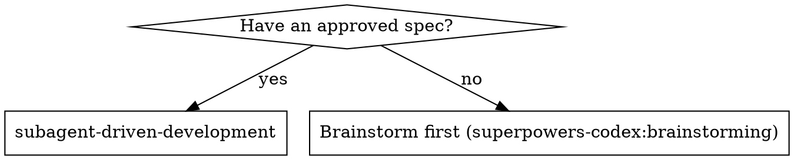
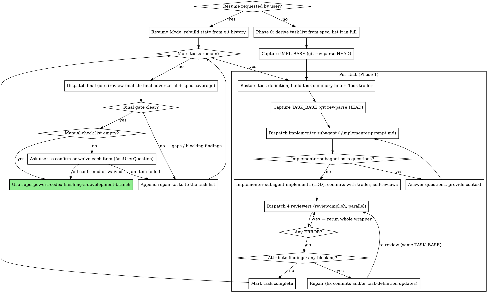

# Subagent-Driven Development

Implement an approved spec in two phases. Phase 0 derives a code-free task list from the spec.
Phase 1 dispatches a fresh implementer subagent per task, followed by one batched review: four
reviewers (spec-compliance, code-quality, task-coverage, task-seam) run in parallel via one
`review-impl.sh` call. After all tasks pass, one `review-final.sh` call (final-adversarial +
spec-coverage) gates the merge.

**Why subagents:** You delegate tasks to specialized agents with isolated context. By precisely crafting their instructions and context, you ensure they stay focused and succeed at their task. They should never inherit your session's context or history — you construct exactly what they need. This also preserves your own context for coordination work.

**Core principle:** Code-free task list from the spec + fresh subagent per task + one batched four-reviewer review per task + one final gate = high quality, fast iteration

**Continuous execution:** Do not pause to check in with your human partner after Phase 0 or between tasks. There is no task-list review and no approval gate — the user already approved the spec. The only reasons to stop are: BLOCKED status you cannot resolve; ambiguity that genuinely prevents progress (including a spec problem that needs a spec edit, see **Mid-Implementation Spec Edits**); a fail-closed condition in **Resume Mode**; a non-empty manual-check list after the final gate passes (see **Manual-Check Disposition**); a refuted finding raised for three consecutive runs (see **Verify Findings Before Acting**); or all tasks complete with the final gate clear. "Should I continue?" prompts and progress summaries waste their time — they approved the spec, so implement it.

## When to Use



There is no alternative execution path for an approved spec. Tightly coupled work is handled in
Phase 0: order the tasks by dependency and merge tightly coupled pieces (including any dependency
cycle) into one task, per `./task-list-format.md`.

An approved spec is a committed design spec under `docs/superpowers/specs/` that your human
partner explicitly approved (normally handed off by `superpowers-codex:brainstorming`). Its path is
`<SPEC>` below and is the `--spec` for every review wrapper call.

## The Process



## Phase 0: Derive the Task List

1. Read the whole spec at `<SPEC>`.
2. Apply the **Scope Check** and **File Structure** guidance in `./task-list-format.md`.
3. Write every task in the task definition format from `./task-list-format.md` (`Spec:`, `Files:`,
   `Interface:`, `Acceptance:`, `Depends on:`). Order the tasks so `Depends on:` only references
   lower-numbered tasks; merge any dependency cycle into one task. Tasks contain no code.
4. **List the complete task list in your reply.** That listing is the authoritative copy.
5. If the harness's task-tracking tool is available, mirror the list into it: one entry per task
   titled `Task N: <name>`, kept in sync as tasks progress. This is a progress display for your
   human partner only — **correctness never depends on it**.
6. Never write the task list to a file and never commit it.
7. Do not ask for review or approval of the list; capture `IMPL_BASE` and start Phase 1.

At the start of every task, restate that task's full definition in your reply, so context
compaction cannot silently lose it. If the list is lost within the session, rebuild it from git
history with the **Resume Mode** steps.

## Base SHA Tracking

You must capture two SHAs at specific moments and keep them in your session state (never in a file):

- **`IMPL_BASE`** — run `git rev-parse HEAD` once, after Phase 0 and before any implementer starts. This is the `--base` passed to the final `review-final.sh` gate.
- **`TASK_BASE`** — run `git rev-parse HEAD` immediately before dispatching each task's implementer. Reset for each task. This is the `--task-base` passed to `review-impl.sh`: the base for every reviewer's `git diff <TASK_BASE>..HEAD` and for the code-quality reviewer's diff. **Do not advance `HEAD` (commit/rebase/checkout) while `review-impl.sh` is running** — all reviewers must see the same HEAD (the engine does not detect HEAD movement; this is a documented caller contract).

Both SHAs must be direct ancestors of HEAD at the time their respective reviewer runs, so capture them at the right moment — not after the fact. In **Resume Mode** both are rebuilt from git history instead.

## Per-Task Flow

1. Restate the task's full definition. Build its **task summary line**
   `Task N: <name> (spec §X, §Y)` (sections = the task's `Spec:`; single line) and its commit
   trailer `Task: <N> <name>`.
2. Capture `TASK_BASE`.
3. Dispatch the implementer with `./implementer-prompt.md`, filling in: the full task definition,
   `<SPEC>` as `[SPEC_FILE_PATH]`, scene-setting context (what earlier tasks built, where the
   `Depends on:` interfaces live), and the trailer as `[TASK_TRAILER]`.
4. Handle the implementer's status (see **Handling Implementer Status**).
5. Run `review-impl.sh` and handle the result (see **Per-Task Batched Review**).
6. When the task passes, mark it complete in your reply and in the task-tracking tool if you
   mirrored the list.

## Reviewer Dispatch

Every reviewer is launched through a `review-*.sh` wrapper, **run from the repository root**.
Run the wrapper calls as written — do NOT pre-probe them with `--help`, `ls`/`find`, or source
greps before dispatching. `${CLAUDE_PLUGIN_ROOT}` is inline-expanded at load time.

**Invocation discipline (applies to both `review-impl.sh` and `review-final.sh` — run each as a plain foreground Bash call):**

- **Do NOT set `run_in_background`.** This is a single blocking operation and you have to wait for
  the review to finish anyway — run it in the foreground.
- **Do NOT append `echo "EXIT_CODE=$?"`** or any exit-code probe. On a nonzero exit Claude Code
  surfaces the code to you automatically, and the wrapper's authoritative status is its stdout
  `=== Summary ===`, not the process exit code.
- **The command line is the wrapper and its arguments — nothing else.** Forbidden: `>`, `>>`, `2>`,
  `2>&1`, `&>`, `|`, `tee`; no `$(...)` or backtick wrapping; no chaining other commands with `&&`,
  `||`, or `;`. Forbidden examples: `>/dev/null`, `2>/dev/null`, `&>/dev/null`, `| grep Status`,
  `| grep -A`, `| tail -50`, `| head`, `> out.txt`, `| tee out.txt`. Filtering or discarding output
  loses the full findings and the `[stderr excerpt]`, and makes `(prose — 見全文)` reviewers
  impossible to interpret. If the output is too long or the call times out, Claude Code writes the
  complete output to a file on its own — read that file in segments; never filter it yourself.
- **Exit 3 means the wrapper's stdout or stderr was redirected to /dev/null.** No reviewer ran and
  there is no `=== Summary ===`. Remove ALL redirections and pipes from the command and re-run it
  with the same arguments.
- **If the foreground call times out**, do NOT re-run it and do NOT poll for its output. It becomes a
  background task; end your turn and wait for Claude Code's completion notification, then read the
  captured output file.

### Per-Task Batched Review

The four per-task reviewers run in parallel through ONE `review-impl.sh` call. Fill `<SPEC>` with
the spec path, the summary with the task's current task summary line, and `<TASK_BASE>` with the
SHA captured before this task's implementer started. Substitute the values; do not run verbatim:

```bash
"${CLAUDE_PLUGIN_ROOT}/scripts/review-impl.sh" \
  --spec docs/superpowers/specs/<YYYY-MM-DD-topic>-design.md \
  --task-summary "Task N: <name> (spec §X, §Y)" \
  --task-base <TASK_BASE>
```

| Label | Question it answers | Summary line |
|---|---|---|
| `spec-compliance` | Is what was built right? Spec misunderstandings, approaches that contradict the spec's design decisions, extra work outside the task summary's scope, anything the spec's Non-goals rule out | `Status: OKAY \| Issues Found` |
| `code-quality` | Is it built well? (native code review of `<TASK_BASE>`) | `(prose — 見全文)` |
| `task-coverage` | Is it done? Every requirement in the summary's spec sections, with evidence | `Status: OKAY \| Issues Found` |
| `task-seam` | Does it fit the existing code? Interface consistency with callers/callees, no spec/task references in code or comments, no leftover placeholders or stubs (does not read the spec) | `Status: OKAY \| Issues Found` |

Reviewers never see the task list; the task summary line is the only scope information they get.
It must be a single line — a newline makes the dispatcher reject the call and the wrapper fails;
rewrite it as one line and re-run.

**Caller control-flow (read stdout on ANY exit code):**

1. **Regardless of the wrapper's exit code, read and parse its entire stdout** and locate the
   `=== Summary ===` section — stdout is preserved in full even on a nonzero exit. **Exception:**
   exit 3 produces no Summary — handle it by the exit-3 rule above instead of Summary parsing.
   A `- backend:` line in the Summary is an informational line, not a reviewer, and takes no part
   in the loop's ERROR / verdict decisions.
2. Classify each reviewer from its Summary line: spec-compliance, task-coverage, and task-seam as
   `Status: OKAY` / `Status: Issues Found`; code-quality as `(prose — 見全文)` — read its full
   `## code-quality` section and treat any blocking-severity defect as a finding; or
   `ERROR (tool failed, ...)`.
3. **If any reviewer is ERROR** → **re-run the entire `review-impl.sh` call** (same
   `--spec`/`--task-summary`/`--task-base`). Do not treat ERROR as a review failure and do not
   discard stdout.
4. **If a reviewer's Summary line carries a `(tool exit N)` annotation** (a `Status:`/`Verdict:`
   was produced but the tool then exited nonzero), the result exists but its output may be
   incomplete: read that reviewer's full `## <label>` section and use judgment — re-run the whole
   `review-impl.sh` call if the output looks truncated, otherwise act on the result shown. Neither
   an automatic pass nor a forced rerun.
5. **Otherwise**, verify every finding (see **Verify Findings Before Acting**), disclose every new
   finding to your human partner (see **Disclose Findings to the User**), attribute every
   confirmed finding (see **Finding Attribution**), record any manual-check items (see
   **Manual-Check Items**), and repair every confirmed blocking finding in one pass. Then re-run
   the whole `review-impl.sh` call with the same `<TASK_BASE>` and the task's current summary line.

**Pass condition:** in a single run with no edits in between, every `Status:` reviewer is either
`Status: OKAY` or has only findings you attributed to a later task or refuted with recorded
counter-evidence, code-quality has no confirmed blocking finding, and no escalation is pending (a
refuted finding raised in three consecutive runs must be settled with your human partner first).

### Verify Findings Before Acting

Reviewer findings, and the fixes reviewers suggest, are not automatically correct. Before acting on
any finding from any reviewer (per-task or final gate) — before changing code, the spec, or a task
definition, and before dispatching an implementer — verify it against the actual sources:

- read the files and lines the finding cites and confirm the described content or behavior really
  exists;
- compare against the spec text, confirming the requirement the reviewer quotes or paraphrases is
  really what the spec says;
- run commands when needed (tests, grep, `git diff`, `git log`) to get evidence.

A reviewer's suggested fix (patch, replacement code, approach) is only a suggestion: decide the
correct fix yourself and confirm it is sound before handing it to an implementer.

| Result | Action |
|---|---|
| **Confirmed** — the sources support the finding | Handle it normally: **Finding Attribution** and the repair table (per-task), or the final-gate rules |
| **Refuted** — the sources contradict the finding | Do not act on it. Record verifiable counter-evidence in your reply (exact `file:line` content, quoted spec text, or command output) and mark the finding refuted |
| **Undecidable** — it can be neither confirmed nor refuted | Treat it as confirmed |

Limits on refutation (so it never becomes a loophole):

- Refute only findings that contradict the facts: the cited code does not exist, the "missing"
  test exists, the described behavior differs from what actually runs, the quoted requirement is
  not what the spec says. "Looks fine" or "unlikely to happen" is not counter-evidence.
- A finding that is correct but seems not worth fixing is not refuted. At the final gate it can
  only be suppressed by the spec-adjudicated carve-out; otherwise it blocks.
- A refuted finding raised again without new evidence stays refuted — do not re-fix it. Raised
  with new evidence, verify it again.
- If the same refuted finding is raised in **three consecutive runs** of the same wrapper, stop
  relying on your refutation: use `AskUserQuestion` to give your human partner the finding, your
  counter-evidence, and the reviewer's argument, and act on their decision.

**Disclose Findings to the User:** this applies to every reviewer, per-task (`review-impl.sh`) and
final gate (`review-final.sh`). After the round's results are received and verified, and BEFORE
repairing, attributing, skipping, or escalating any finding, tell your human partner about every NEW
finding in your reply: at least one sentence per finding, each describing the problem that finding
points out. One sentence is a minimum, not a maximum; never merge several findings into one brief
sentence. "New" means first raised this round, or belonging to an existing topic but raising a new
argument or new evidence; an exact repeat with no new evidence may be omitted. Findings you will fix
directly, refuted, or skip as a spec-adjudicated rejection are disclosed too. This is a disclosure,
not a question: do not wait for a reply.

**Describe the problem before asking:** before ANY `AskUserQuestion` call in this skill (refuted-finding
escalation, Manual-Check Disposition, Mid-Implementation Spec Edits, Resume Mode), first describe the
problem in detail in your reply text: the scenario, the impact, each option's approach and cost, and
your recommendation if you have one. The `AskUserQuestion` option descriptions must not be the first
place the user sees the problem.

**Code-quality severity calibration:** "blocking" = what a senior engineer would require fixed
before merge — bugs, data-loss risks, broken error handling, security issues, missing critical
test coverage. Style preferences do not trigger a re-review loop. Code-quality cannot exclude the
spec file from its review; ignore its comments on spec text. **Do not ask the user** — the loop
runs automatically until the gate clears.

### Finding Attribution

Reviewers cannot see the task list, so task-coverage (and spec-compliance) may report requirements
that a later task owns. You hold the list, so you classify every finding.

**Belongs to a later task** — only when ALL three hold:

1. The task list really contains a not-yet-complete task whose `Acceptance:` **explicitly covers**
   the item;
2. that task's `Spec:` (and so its task summary line) includes the spec section the item comes
   from — so that task's task-coverage reviewer will check it;
3. the item is **not a prerequisite** of the current task (the current task's implementation or
   tests do not need it).

For each such finding, state in your reply the receiving task's number and the exact `Acceptance:`
entry. These findings neither block the current task nor get fixed now.

**Prerequisite guard:** a prerequisite of the current task is always blocking, even if a later
task already lists it. Fold it into the current task (table below) and remove the entry from the
task that held it.

**Everything else is blocking:** no explicitly covering task, only partial overlap, or any doubt.
This rule is deliberately conservative so attribution never becomes a loophole.

Repair paths for blocking findings:

| Finding | Repair |
|---|---|
| Implementation error (any reviewer) | Implementer fixes and commits |
| The current task missed a requirement no task covers | Add the entry to the current task's `Acceptance:`; implementer implements it |
| The requirement fits a later task better, but no task covers it | Add the entry to a not-yet-complete task's `Acceptance:` and its section to that task's `Spec:`, or append a new task. Do not implement it now. **Not allowed** if the current task's implementation or tests need it — then use the row above |
| Making the current task work requires changing a completed task's code | Fold that change into the current task's `Acceptance:`; the current implementer does it. Never append a separate repair task the current task would have to wait for |

**Scope-sync rule:** whenever any task's `Acceptance:` gains or changes an entry (any row above,
including folding work into the current task), add the entry's spec section to that task's `Spec:`
and regenerate its task summary line; every later `review-impl.sh` call for that task uses the new
line. If the entry changes what the task exposes or what it consumes, update `Interface:` and
`Depends on:` too (`Depends on:` still references only lower-numbered tasks). Reviewers never see
`Acceptance:`; only the summary line keeps spec-compliance from flagging the folded work as out of
scope and makes task-coverage check it.

**Re-run after any change:** after any repair, re-run the whole `review-impl.sh` (same
`<TASK_BASE>`) — including when only a task definition changed and nothing was committed.

**Never loosen `Acceptance:` to get a reviewer to pass.** A definition may change only to match the
spec more closely, never to accommodate the implementation.

### Manual-Check Items

spec-compliance, task-coverage, and spec-coverage may mark an item as inherently requiring manual
verification (external side effects, behavior only a human can observe). Such items do not block.
Record each in your session state with its content, source reviewer, and task; it is handled in
**Manual-Check Disposition**.

### Final Gate

After all tasks pass, the final gate runs through ONE `review-final.sh` call. Fill `<IMPL_BASE>`
with the SHA captured before the first implementer started and `<SPEC>` with the spec path;
substitute the values, do not run verbatim:

```bash
"${CLAUDE_PLUGIN_ROOT}/scripts/review-final.sh" \
  --base <IMPL_BASE> \
  --spec docs/superpowers/specs/<YYYY-MM-DD-topic>-design.md
```

It runs two reviewers in parallel:

- `final-adversarial` — code-level adversarial review of the whole change (cross-task seams,
  permissions and isolation, data loss, rollback and partial failure, races, observability,
  ship/no-ship). It does not receive the spec. Summary line: `Verdict: approve | needs-attention`.
- `spec-coverage` — reads the whole spec and `git diff <IMPL_BASE>..HEAD`; reports Coverage Gaps
  (requirements without sufficient evidence) and Intent Drift (the tasks together diverging from
  the spec's architecture, responsibilities, data flow, or design direction). Summary line:
  `Status: OKAY | Issues Found`.

Read the wrapper's stdout `=== Summary ===` on any exit code. A `- backend:` line in the Summary is
an informational line, not a reviewer, and takes no part in the ERROR / verdict decisions:

- `ERROR (tool failed, ...)` on either reviewer → a tool failure, not a review result; re-run the
  whole `review-final.sh` call (same `--base`/`--spec`).
- `... (tool exit N)` → the result was produced but the tool then exited nonzero, so the output may
  be incomplete; read that reviewer's full `## <label>` section and use judgment — re-run
  `review-final.sh` if it looks truncated, otherwise act on the result shown.

**Final gate pass condition:** in a single run, `spec-coverage` is `Status: OKAY` (or its only
remaining findings are refuted with recorded counter-evidence) and `final-adversarial` is
`Verdict: approve` (or its only remaining findings are non-blocking spec-adjudicated rejections,
below, or refuted), with no escalation pending. Verify every final-gate finding first (**Verify Findings Before Acting**), then disclose every new one (**Disclose Findings to the User**). All
tasks are complete, so "belongs to a later task" no longer applies: every confirmed spec-coverage
gap or drift item is blocking.

**Repairs go through appended tasks.** For every confirmed spec-coverage item and every confirmed
blocking final-adversarial finding, append one or more new tasks to the end of the task list: new number and
name, `Spec:` and `Acceptance:` per `./task-list-format.md` (for a final-adversarial finding,
`Spec:` is the spec section the finding touches). List the appended tasks in your reply. Each one
runs the full Per-Task Flow (own `TASK_BASE`, own `Task:` trailer, four reviewers). When all are
complete, re-run the whole `review-final.sh` with the same `<IMPL_BASE>`. Never dispatch an
implementer to fix final-gate findings outside a task — every commit belongs to exactly one task.

**Respect spec-adjudicated rejections (narrow carve-out):** Before turning final-adversarial findings into tasks, read the **Non-goals / Accepted limitations** section of the source spec. If a finding is *clearly the same concern* as an item the spec records there as an accepted limitation (an `adjudicated-reject` from brainstorming), treat that finding as **non-blocking** — do not implement it, and note in your report which accepted limitation it maps to (quote the recorded concern). This does not ask the user; it honors a decision the user already made.

- **Conservative matching (this bypasses the merge gate — fail safe):** suppress only when the finding is clearly the same concern the user rejected. If the overlap is partial, the scope differs, or the match is ambiguous, **default to blocking** and handle it as a normal finding.
- **Premise check before suppression:** before suppressing, state in your report the premise the accepted limitation rested on (its recorded rationale) and confirm it still holds for the current implementation. If implementation drift changed that premise, or you cannot confirm it holds, the rejection has lapsed — the finding **blocks** as normal.
- **Source spec = the spec passed to `review-final.sh --spec`.** Read *only* that spec's **Non-goals / Accepted limitations** section. If you cannot locate that section, suppress nothing — treat every finding as blocking.
- All findings not covered by a spec-adjudicated rejection are handled exactly as before.

**Caller HEAD contract:** Do not advance `HEAD` while `review-final.sh` is running — the reviewers
diff `<IMPL_BASE>..HEAD`. Commit any fixes before re-running the gate, not while it runs.

**Zero tolerance, except spec-adjudicated rejections above; do not ask the user** — the loop runs automatically until the gate clears.

### Manual-Check Disposition

After the final gate passes and before `superpowers-codex:finishing-a-development-branch`:

- If the manual-check list is empty, do not interrupt — go straight to finishing.
- Otherwise list every item (content, source reviewer, task) and use `AskUserQuestion` to have your
  human partner confirm each one has been verified, or explicitly waive it.
- An item the user reports as failing is treated like a final-gate gap: append a task for it, run
  it through the Per-Task Flow, then re-run the whole `review-final.sh`.

This is the only stop point after the final gate.

## Commit Trailer

Every implementer commit — including fix commits after review — ends its message with the trailer

```
Task: <N> <name>
```

for example `Task: 3 Retry policy`, where `<N>` and `<name>` match the task definition exactly. It
sits in the message's final paragraph alongside other trailers such as `Co-Authored-By:`.

- You give the implementer the exact trailer string; the implementer never invents it.
- Its only purpose is letting **Resume Mode** group commits by task from `git log`. The normal flow
  does not read it.
- A trailer is commit metadata, not code: task-seam's "no task references in code or comments" rule
  does not apply to it.

## Mid-Implementation Spec Edits

If a serious problem means the spec itself must change:

- Only you (the controller) edit the spec, and only after your human partner agrees via
  `AskUserQuestion`. Implementers never edit the spec file.
- Commit the spec edit **on its own**: only the spec file, no `Task:` trailer, message
  `docs(spec): ...`. Never commit it while a review wrapper is running.
- Then update the not-yet-complete task definitions to the new spec, following the scope-sync rule.
  If completed tasks are affected, append a task or fold the work into the current task per the
  repair table.
- Reviewers treat changes to the spec file in the diff as not implementation; ignore code-quality
  comments on spec text.

## Resume Mode

Enter Resume Mode **only** when your human partner explicitly asks you to resume implementing a
spec. The normal flow (handoff from brainstorming) never probes git history.

0. **Interrupted-work check.** Run `git status --porcelain`. Staged or unstaged changes to tracked
   files, and untracked files that look like part of this spec's implementation (for example new
   source or test files an interrupted implementer never added), are a fail-closed condition —
   usually implementation interrupted before commit. Judge untracked files yourself: ignore files
   unrelated to the implementation (they typically existed before it started) without asking. Do
   not silently ignore interrupted work. Ask your human partner via `AskUserQuestion` to choose:
   (a) **revert and redo** — discard the changes (restore tracked files, delete the related
   untracked files) and redo the interrupted task from scratch; or (b) **keep and continue** —
   you decide which task the changes belong to (usually the last task in trailer order, or the
   next task with no commits yet), dispatch an implementer to finish that task on top of the
   existing changes, committing with that task's trailer; its `TASK_BASE` follows step 5 if the
   task already has commits, otherwise it is the current `HEAD`. If you cannot tell which task
   the changes belong to, say so in the same question. Uncommitted changes to the spec file itself
   (a spec edit interrupted before its commit) belong to no task: in the same question, ask whether
   to keep the edit (you commit it on its own per **Mid-Implementation Spec Edits**, no `Task:`
   trailer) or discard it. Settle the spec first, then rebuild the task list from the committed
   spec and handle the remaining implementation changes.
1. **Locate the start.** `<S>` = the SHA of the commit that added the spec, printed by
   `git log --diff-filter=A --format=%H -- <SPEC>`.
2. **Rebuild `IMPL_BASE`.** List the trailers in order, substituting the SHA for `<S>`:
   `git log --reverse --format='%H %(trailers:key=Task,valueonly)' <S>..HEAD`.
   `IMPL_BASE` = the parent of the first commit carrying a `Task:` trailer. Spec-edit commits carry
   no trailer and do not affect this.
3. **Group** the trailer-carrying commits in `IMPL_BASE..HEAD` by trailer.
4. **Rebuild the task list.** Derive the task list from the **current** spec, then match it against
   the groups and the code to decide which tasks are complete.
   - **Historical identity:** every task that appears in a trailer keeps that trailer's number and
     name verbatim; its later commits use that same trailer. Tasks with no history are numbered
     after the highest historical number. Match by trailer name and commit content, not by
     derivation order.
   - **Only the last group may receive new commits** with its trailer (step 5). Every earlier
     historical task is closed. Work a closed task now needs under the current spec is handled
     per the repair table: fold it into the current task if it is a prerequisite, otherwise
     append a new task (new number, new trailer).
5. **The last task** in trailer order is always treated as **not yet reviewed**. Its `TASK_BASE` =
   the parent of its first commit. Run `review-impl.sh` with it first, then handle findings
   normally.
6. Continue the normal flow from the next incomplete task. The final gate uses the rebuilt
   `IMPL_BASE`, so it covers the whole implementation, including earlier sessions.
7. List the rebuild result in your reply (`IMPL_BASE`, each task's status and commits), then
   continue without waiting for confirmation.

**Fail closed:** if any of the following holds, list the current rebuild result and the doubts,
and confirm with your human partner via `AskUserQuestion` before continuing — never guess:

- Interrupted work remains in the worktree (step 0) — the question is revert-and-redo or keep-and-continue.
- The commit that added the spec cannot be found, or no commit in `<S>..HEAD` carries a `Task:`
  trailer.
- Anywhere in **all of `<S>..HEAD`** (including before the first trailer-carrying commit) there is a
  commit without a trailer that changes anything other than the spec file
  (check with `git show --name-only --format= <sha>`). It may belong to an unknown task, be
  unrelated to this spec, or be implementation started without trailers; in the last case your
  human partner must specify `IMPL_BASE` and which task each such commit belongs to.
- Commits of one task interleave with commits of another task.
- The task list derived from the current spec cannot be matched to the tasks in the trailers.

## Model Selection

Use the least powerful model that can handle each role to conserve cost and increase speed.
Tasks carry no code — the implementer designs the code and tests — so judge complexity by how much
design the task requires.

**Mechanical implementation tasks** (isolated functions, precise spec, 1-2 files, an `Interface:`
that leaves little to decide): use a fast, cheap model.

**Integration and judgment tasks** (multi-file coordination, pattern matching, debugging, design
choices the spec leaves open): use a standard model.

**Architecture, design, and review tasks**: use the most capable available model.

**Task complexity signals:**

- Touches 1-2 files with a precise spec and fixed interface → cheap model
- Touches multiple files with integration concerns → standard model
- Requires design judgment or broad codebase understanding → most capable model

## Handling Implementer Status

Implementer subagents report one of four statuses. Handle each appropriately:

**DONE:** Proceed to the per-task batched review.

**DONE_WITH_CONCERNS:** The implementer completed the work but flagged doubts. Read the concerns before proceeding. If the concerns are about correctness or scope, address them before review. If they point at a problem in the spec, follow **Mid-Implementation Spec Edits**. If they're observations (e.g., "this file is getting large"), note them and proceed to review.

**NEEDS_CONTEXT:** The implementer needs information that wasn't provided. Provide the missing context and re-dispatch. If it lists third-party API behavior the spec does not document, obtain a confirmed answer through a research subagent (following your human partner's rules for researching third-party packages, if any) and re-dispatch with that answer — never answer from memory.

**BLOCKED:** The implementer cannot complete the task. Assess the blocker:
1. If it's a context problem, provide more context and re-dispatch with the same model
2. If the task requires more reasoning, re-dispatch with a more capable model
3. If the task is too large: when it has **no commits yet**, split it into smaller tasks (keep `Depends on:` pointing only at lower-numbered tasks); when it **already has commits**, keep its identity — dispatch the remaining work as sequential implementer assignments under the same task, trailer, and `TASK_BASE`, then review their combined result with one `review-impl.sh` run. Never split a task that has commits into new task numbers.
4. If the spec itself is wrong, follow **Mid-Implementation Spec Edits**

**Never** ignore an escalation or force the same model to retry without changes. If the implementer said it's stuck, something needs to change.

## Sidecar files

- `./implementer-prompt.md` — implementer subagent prompt (you fill and dispatch it directly)
- `./task-list-format.md` — task definition format, task summary line, decomposition guidance
- `./spec-reviewer-prompt.md` — spec-compliance reviewer prompt (dispatched by `review-impl.sh`)
- `./task-coverage-prompt.md` — task-coverage reviewer prompt (dispatched by `review-impl.sh`)
- `./task-seam-prompt.md` — task-seam reviewer prompt (dispatched by `review-impl.sh`)
- `./spec-coverage-prompt.md` — spec-coverage reviewer prompt (dispatched by `review-final.sh`)
- `./final-code-reviewer-focus.md` — final-adversarial focus text (passed by `review-final.sh`)

## Example Workflow

```
You: I'm using Subagent-Driven Development to implement docs/superpowers/specs/2026-05-02-hooks-design.md.

[Phase 0: read the whole spec, derive 5 tasks, list them in full:]
  Task 1: Hook installation script
  Spec: §3.1
  Files: scripts/install-hook.sh (new), tests/install-hook.test.sh (new)
  Interface: install-hook [--force] <hook-name>
  Acceptance:
  - installs into ~/.config/superpowers/hooks/
  - refuses to overwrite without --force
  Depends on: none
  ... (Tasks 2-5 in full)
[Mirror into the task-tracking tool, if available]

[Capture IMPL_BASE: git rev-parse HEAD -> abc1234]

Task 1: Hook installation script
[Restate Task 1's definition]
[Capture TASK_BASE: git rev-parse HEAD -> abc1234 (same as IMPL_BASE before any work)]
[Dispatch implementer: full definition + spec path + context + trailer "Task: 1 Hook installation script"]

Implementer: "Before I begin - should the hook be installed at user or system level?"
You: "User level (~/.config/superpowers/hooks/), as §3.1 says"
Implementer:
  - Wrote tests, saw them fail on the missing behavior, implemented install-hook
  - 5/5 tests passing; self-review: added the missing --force check
  - Committed with trailer "Task: 1 Hook installation script"

[review-impl.sh --spec docs/superpowers/specs/2026-05-02-hooks-design.md \
   --task-summary "Task 1: Hook installation script (spec §3.1)" --task-base abc1234]
=== Summary ===
- spec-compliance: Status: OKAY
- code-quality: (prose — 見全文)      [no blocking finding]
- task-coverage: Status: OKAY
- task-seam: Status: OKAY
[Task 1 passes; mark complete]

Task 2: Recovery modes   (Spec: §3.2, §3.3)
[Restate definition; capture TASK_BASE -> def5678; dispatch implementer]
Implementer: verify/repair modes, 8/8 tests passing, committed with "Task: 2 Recovery modes"

[review-impl.sh ... --task-summary "Task 2: Recovery modes (spec §3.2, §3.3)" --task-base def5678]
=== Summary ===
- spec-compliance: Status: OKAY
- code-quality: (prose — 見全文)
- task-coverage: Status: Issues Found
- task-seam: Status: OKAY
[Read the full ## task-coverage and ## code-quality sections above:
  task-coverage: §3.3 "report progress every 100 items" and §3.3 "--json output" not met
  code-quality: src/recovery.ts:47 repair mode swallows write errors and still reports success]

[Attribution:
  - "--json output": Task 4 (not complete) has Acceptance "- recovery supports --json output",
    its Spec includes §3.3, and Task 2 neither needs it nor tests it -> belongs to Task 4
  - "progress every 100 items": no task covers it -> blocking; add
    "- reports progress every 100 items" to Task 2's Acceptance (§3.3 already in Spec:)
  - swallowed write errors -> broken error handling, blocking implementation fix]
[Implementer fixes both blocking items in one pass, commits with "Task: 2 Recovery modes"]

[Re-run review-impl.sh, same summary, same TASK_BASE]
=== Summary ===
- spec-compliance: Status: OKAY
- code-quality: (prose — 見全文)      [no blocking finding]
- task-coverage: Status: Issues Found
- task-seam: Status: OKAY
[Full ## task-coverage section: only §3.3 "--json output" remains -> still attributed to Task 4]
[Every remaining finding belongs to a later task -> Task 2 passes; mark complete]

... Tasks 3-5 ...

[review-final.sh --base abc1234 --spec docs/superpowers/specs/2026-05-02-hooks-design.md]
=== Summary ===
- final-adversarial: Verdict: approve
- spec-coverage: Status: Issues Found
[Full ## spec-coverage section: Coverage Gaps lists §3.4 "uninstall removes the hook directory
  when empty" with no implementation]
[Append Task 6: Empty hook directory cleanup (Spec: §3.4) and run the full Per-Task Flow]
[Re-run review-final.sh, same IMPL_BASE -> Verdict: approve, Status: OKAY]

[Manual-check list: "hook fires on a real git commit" (task-coverage, Task 1)]
[AskUserQuestion: confirm verified or waive -> user confirms]

Done — proceed to superpowers-codex:finishing-a-development-branch
```

## Advantages

**vs. Implementing everything in the controller session:**
- Subagents follow TDD naturally
- Fresh context per task (no confusion)
- Subagent can ask questions (before AND during work)

**Efficiency gains:**
- The code is written once, by the implementer — tasks carry goals and acceptance criteria, not code
- Controller curates exactly what context is needed; subagent gets the full task definition upfront
- Questions surfaced before work begins (not after)

**Quality gates:**
- Self-review catches issues before handoff
- One batched four-reviewer review per task via `review-impl.sh`, each reviewer answering one question
- Final gate (`review-final.sh`) catches cross-task code problems and spec requirements the task list missed
- Review loops ensure fixes actually work

**Cost:**
- More subagent invocations (implementer + 4 reviewers per task + 2 at the final gate)
- Controller does more coordination (task list, SHAs, finding attribution)
- But catches issues early (cheaper than debugging later)

## Red Flags

**Never:**
- Start implementation on main/master branch without explicit user consent
- Skip reviews (any of the four per-task reviewers, or the final gate)
- Proceed with unfixed issues
- Dispatch multiple implementation subagents in parallel (conflicts)
- Make subagent derive its own task from the spec (provide the full task definition instead)
- Put implementation code, test code, or step-by-step instructions into a task definition
- Write the task list to a file or commit it
- Skip scene-setting context (subagent needs to understand where task fits)
- Ignore subagent questions (answer before letting them proceed)
- Accept "close enough" on spec compliance or coverage (reviewer found issues = not done)
- Attribute a finding to a later task without naming that task and the `Acceptance:` entry that explicitly covers it
- Defer a prerequisite of the current task to a later task
- Loosen a task's `Acceptance:` to get a reviewer to pass
- Change a task's `Acceptance:` without syncing its `Spec:` and task summary line
- Skip the re-run after a fix or a task-definition change
- Pass a multi-line `--task-summary`
- Let an implementer commit without the `Task:` trailer, or invent a trailer yourself instead of the task's exact `Task: <N> <name>`
- Edit the spec without your human partner's consent, or mix a spec edit into an implementation commit
- Fix final-gate findings outside an appended task
- Continue past a Resume Mode fail-closed condition by guessing
- Act on a reviewer finding, or apply a reviewer's suggested patch, without first verifying it against the actual code, spec, or command output
- Fix, skip, or escalate findings without first disclosing each new finding to your human partner, or call `AskUserQuestion` without first describing the problem in prose
- Refute a finding without recorded, verifiable counter-evidence, or refute a correct finding because it seems not worth fixing
- Keep relying on your refutation after the same finding was raised in three consecutive runs
- Skip review loops (reviewer found issues = fix = review again)
- Let implementer self-review replace actual review (both are needed)
- Advance HEAD (commit/rebase/checkout) while `review-impl.sh` or `review-final.sh` is running (all reviewers must see the same HEAD)
- Move to next task while any review has open blocking issues
- **Forget to capture `TASK_BASE` before dispatching each task's implementer** (base SHA will be wrong)
- **Forget to capture `IMPL_BASE` before the first implementer starts** (final gate diff will be wrong)
- **Parse a `Verdict:` line from the code-quality reviewer (native review)** — it does not emit one; interpret the prose instead
- Fall back to inline self-review if the `review-*.sh` wrappers are not found — the superpowers-codex plugin is not installed; stop and prompt the user to install it

**If subagent asks questions:**
- Answer clearly and completely
- Provide additional context if needed
- Don't rush them into implementation

**If reviewer finds issues:**
- Verify each finding first; refute the false ones with counter-evidence
- Disclose each new finding to your human partner before acting
- Attribute each confirmed finding; repair every confirmed blocking one
- Implementer (same subagent) fixes implementation errors
- Re-run the whole review
- Repeat until the task passes

**If subagent fails task:**
- Dispatch fix subagent with specific instructions
- Don't try to fix manually (context pollution)

## Integration

**Required workflow skills:**
- **superpowers-codex:brainstorming** - Produces the approved spec this skill implements and hands off to it
- **superpowers-codex:finishing-a-development-branch** - Complete development after the final gate clears
